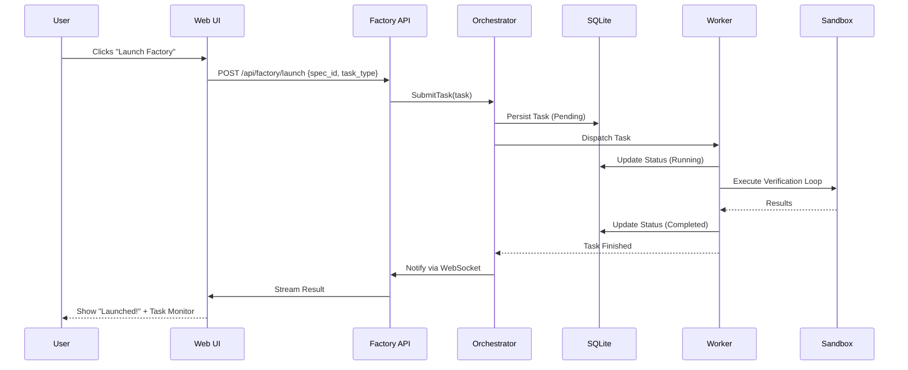

# Next UI Phase: One-Click Factory Launch (GitHub Code Review Style)

## Goal
Enable launching the Agentic Software Factory with a single click from the Web UI — similar to how GitHub's "Code Review" or "Merge" buttons trigger automated workflows.

## Architecture Overview

```
┌─────────────────────────────────────────────────────────────────┐
│                        WEB UI (Next.js)                         │
│  ┌───────────────────────────────────────────────────────────┐  │
│  │  Factory Dashboard                                         │  │
│  │  ┌─────────┐  ┌─────────┐  ┌─────────┐  ┌─────────┐       │  │
│  │  │ Context │  │  Specs  │  │ Verify  │  │ Factory │  🚀  │  │
│  │  │  Eng.   │  │  Eng.   │  │         │  │ Orch.   │ LAUNCH│  │
│  │  └─────────┘  └─────────┘  └─────────┘  └─────────┘       │  │
│  └───────────────────────────────────────────────────────────┘  │
└─────────────────────────────────────────────────────────────────┘
                              │
                              ▼
┌─────────────────────────────────────────────────────────────────┐
│                    ASF CLI / Factory API                        │
│  POST /api/factory/launch  ──►  Factory Orchestrator           │
│                              │                                  │
│                              ▼                                  │
│                    ┌───────────────────────┐                   │
│                    │  Worker Pool (4)      │                   │
│                    │  ┌─────┐ ┌─────┐     │                   │
│                    │  │ W1  │ │ W2  │ ... │                   │
│                    │  └─────┘ └─────┘     │                   │
│                    └───────────────────────┘                   │
└─────────────────────────────────────────────────────────────────┘
```

## Implementation Plan

### 1. API Layer (Backend)

#### Add Launch Endpoint to `cmd/asf-web/main.go`
```go
mux.HandleFunc("/api/factory/launch", w.handleLaunchFactory)

func (w *webServer) handleLaunchFactory(w http.ResponseWriter, r *http.Request) {
    if r.Method != http.MethodPost {
        w.writeJSON(map[string]string{"error": "method not allowed"})
        return
    }

    var req struct {
        SpecID    string `json:"spec_id"`
        TaskType  string `json:"task_type"`  // generate, verify, review, refactor
        Priority  int    `json:"priority"`
        Parameters map[string]interface{} `json:"parameters"`
    }
    
    if err := json.NewDecoder(r.Body).Decode(&req); err != nil {
        w.writeJSON(map[string]string{"error": "invalid request"})
        return
    }

    task := &factory.Task{
        Type:       req.TaskType,
        SpecID:     req.SpecID,
        Priority:   req.Priority,
        Parameters: req.Parameters,
    }

    if err := w.factory.SubmitTask(task); err != nil {
        w.writeJSON(map[string]string{"error": err.Error()})
        return
    }

    w.writeJSON(map[string]interface{}{
        "task_id": task.ID,
        "status":  "queued",
        "message": "Factory task launched successfully",
    })
}
```

### 2. Frontend Components

#### A. Launch Button Component (`web-ui/src/components/LaunchButton.tsx`)
```tsx
interface LaunchButtonProps {
  specId: string;
  taskType: 'generate' | 'verify' | 'review' | 'refactor';
  disabled?: boolean;
}

export function LaunchButton({ specId, taskType, disabled }: LaunchButtonProps) {
  const [status, setStatus] = useState<'idle' | 'loading' | 'success' | 'error'>('idle');
  const [taskId, setTaskId] = useState<string | null>(null);

  const handleLaunch = async () => {
    setStatus('loading');
    try {
      const res = await fetch('/api/factory/launch', {
        method: 'POST',
        headers: { 'Content-Type': 'application/json' },
        body: JSON.stringify({ specId, taskType, priority: 1 }),
      });
      const data = await res.json();
      if (data.task_id) {
        setTaskId(data.task_id);
        setStatus('success');
        // Poll for completion
        pollTaskStatus(data.task_id);
      } else {
        setStatus('error');
      }
    } catch {
      setStatus('error');
    }
  };

  const pollTaskStatus = async (id: string) => {
    // WebSocket or polling implementation
  };

  return (
    <button
      onClick={handleLaunch}
      disabled={disabled || status === 'loading'}
      className={cn(
        'px-4 py-2 rounded-lg font-medium transition-all',
        'hover:shadow-lg active:scale-[0.98]',
        status === 'loading' ? 'bg-indigo-600 cursor-wait' :
        status === 'success' ? 'bg-green-600' :
        'bg-indigo-600 hover:bg-indigo-700'
      )}
    >
      {status === 'loading' && <Loader2 className="w-4 h-4 mr-2 animate-spin" />}
      {status === 'success' && <Check className="w-4 h-4 mr-2" />}
      {status === 'idle' && <Play className="w-4 h-4 mr-2" />}
      <span>{status === 'loading' ? 'Launching...' : 
               status === 'success' ? 'Launched!' : 'Launch Factory'}</span>
    </button>
  );
}
```

#### B. Task Status Monitor Component (`web-ui/src/components/TaskStatusMonitor.tsx`)
```tsx
interface TaskStatusMonitorProps {
  taskId: string;
  onComplete?: (result: TaskResult) => void;
}

export function TaskStatusMonitor({ taskId, onComplete }: TaskStatusMonitorProps) {
  const [status, setStatus] = useState<TaskStatus>('queued');
  const [logs, setLogs] = useState<string[]>([]);

  useEffect(() => {
    const ws = new WebSocket(`${window.location.origin}/api/tasks/${taskId}/stream`);
    ws.onmessage = (event) => {
      const data = JSON.parse(event.data);
      if (data.log) setLogs(prev => [...prev, data.log]);
      if (data.status) {
        setStatus(data.status);
        if (data.status === 'completed' || data.status === 'failed') {
          ws.close();
          onComplete?.(data);
        }
      }
    };
    return () => ws.close();
  }, [taskId]);

  return (
    <div className="fixed inset-0 bg-black/50 flex items-center justify-center z-50">
      <div className="bg-white dark:bg-gray-800 rounded-xl p-6 max-w-md w-full mx-4">
        <div className="flex items-center justify-between mb-4">
          <h3 className="font-semibold">Factory Task</h3>
          <Badge variant={status === 'completed' ? 'success' : status === 'failed' ? 'destructive' : 'default'}>
            {status}
          </Badge>
        </div>
        <div className="font-mono text-sm max-h-64 overflow-auto bg-gray-100 dark:bg-gray-900 p-4 rounded">
          {logs.map((log, i) => <div key={i}>{log}</div>)}
        </div>
        {status === 'completed' && (
          <Button onClick={() => onComplete?.({ success: true })} className="w-full mt-4">
            View Results
          </Button>
        )}
      </div>
    </div>
  );
}
```

### 3. API Extensions

#### Add to `cmd/asf-web/main.go`
```go
// WebSocket endpoint for real-time task updates
mux.HandleFunc("/api/tasks/", w.handleTaskStream)

func (w *webServer) handleTaskStream(w http.ResponseWriter, r *http.Request) {
    taskID := strings.TrimPrefix(r.URL.Path, "/api/tasks/")
    taskID = strings.TrimSuffix(taskID, "/stream")
    
    conn, err := upgrader.Upgrade(w, r, nil)
    if err != nil {
        return
    }
    defer conn.Close()

    // Stream task updates
    ticker := time.NewTicker(2 * time.Second)
    defer ticker.Stop()

    for range ticker.C {
        task, ok := w.factory.GetTaskResult(taskID)
        if !ok {
            continue
        }
        
        conn.WriteJSON(map[string]interface{}{
            "status": task.Status,
            "log": fmt.Sprintf("[%s] Task %s: %s", 
                time.Now().Format("15:04:05"), taskID, task.Status),
        })

        if task.Status == "completed" || task.Status == "failed" {
            conn.WriteJSON(map[string]interface{}{
                "status": task.Status,
                "result": task.Result,
                "error": task.Error,
            })
            break
        }
    }
}
```

### 4. Dashboard Integration

Update `web-ui/src/app/page.tsx` to include the launch button in the Factory card:

```tsx
{/* Factory Orchestration Card with Launch Button */}
<div className="group bg-white rounded-xl border border-gray-200 p-6 hover:shadow-xl transition-shadow duration-300 dark:bg-gray-800 dark:border-gray-700 dark:hover:shadow-gray-800/30">
  <div className="flex items-center gap-3 mb-4">
    <div className="w-10 h-10 rounded-lg bg-orange-100 dark:bg-orange-900/20 flex items-center justify-center">
      <svg className="w-5 h-5 text-orange-600 dark:text-orange-400" fill="none" stroke="currentColor" viewBox="0 0 24 24">
        <path strokeLinecap="round" strokeLinejoin="round" strokeWidth="2" d="M4 6h16M4 12h16M4 18h16"/>
      </svg>
    </div>
    <div>
      <h3 className="text-sm font-medium text-gray-900 dark:text-gray-100">Factory Orchestration</h3>
      <p className="text-xs text-gray-500 dark:text-gray-400">Worker pools & task queues</p>
    </div>
  </div>
  <p className="text-sm text-gray-500 dark:text-gray-400 mt-2">
    Factory orchestrator with auto-scaling worker pools, SQLite persistence, and task recovery
  </p>
  
  {/* One-Click Launch Button */}
  <div className="mt-4 pt-4 border-t border-gray-200 dark:border-gray-700">
    <LaunchButton specId="spec-001" taskType="generate" />
  </div>
</div>
```

### 5. Spec Selector Dropdown

Add a spec selector to the dashboard header for choosing which spec to launch:

```tsx
{/* Spec Selector */}
<div className="mb-6 flex items-center gap-4">
  <label className="text-sm font-medium text-gray-700 dark:text-gray-300">Active Spec:</label>
  <select 
    className="px-3 py-2 border border-gray-300 dark:border-gray-600 rounded-lg bg-white dark:bg-gray-800 text-gray-900 dark:text-gray-100"
    onChange={(e) => setActiveSpec(e.target.value)}
    value={activeSpec}
  >
    <option value="spec-001">spec-001: Example Specification</option>
    <option value="spec-002">spec-002: API Generation</option>
    <option value="spec-003">spec-003: Test Generation</option>
  </select>
</div>
```

## Sequence Diagram: One-Click Launch Flow



## Dependencies to Add

```bash
cd web-ui
npm install lucide-react@latest clsx@latest tailwind-merge@latest
npm install -D @types/ws ws
```

## Acceptance Criteria

- [ ] User clicks "Launch Factory" button on dashboard
- [ ] Spec selector dropdown chooses which spec to run
- [ ] POST to `/api/factory/launch` queues task
- [ ] Real-time status updates via WebSocket
- [ ] Modal shows task progress (queued → running → completed)
- [ ] On completion: shows "View Results" button
- [ ] Task status persists in SQLite
- [ ] Error handling for failed launches
- [ ] Loading states during launch
- [ ] Success toast notification on completion

## Timeline

| Phase | Tasks | Est. Time |
|-------|-------|-----------|
| 1. API | Launch endpoint + WebSocket | 2h |
| 2. Frontend | LaunchButton + TaskStatusMonitor + SpecSelector | 3h |
| 3. Integration | Wire API to UI + WebSocket | 2h |
| 4. Polish | Loading states, error handling, toasts | 1h |
| **Total** | | **~8h** |

## Next Steps
1. Implement `/api/factory/launch` endpoint in `cmd/asf-web/main.go`
2. Add WebSocket handler for real-time updates
3. Create React components: `LaunchButton`, `TaskStatusMonitor`, `SpecSelector`
4. Integrate into `page.tsx` dashboard
5. Add WebSocket client hooks
6. Test end-to-end flow