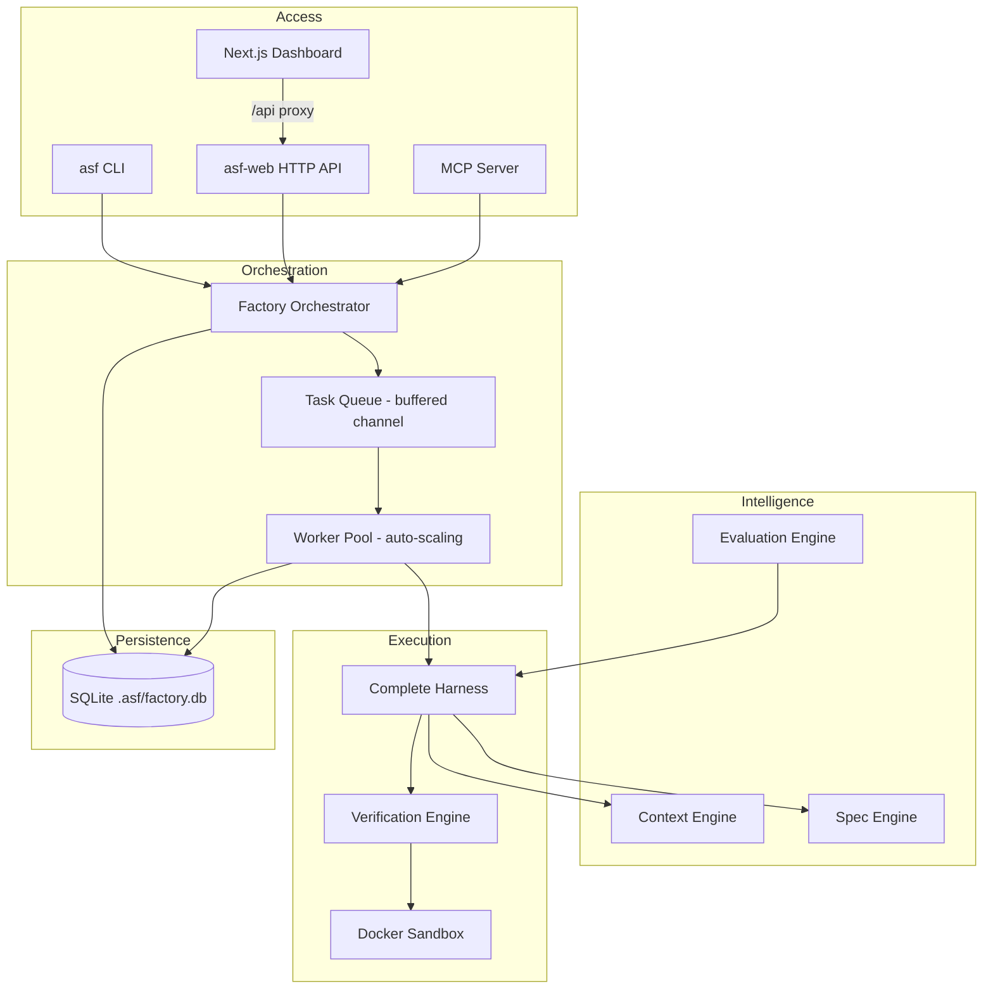
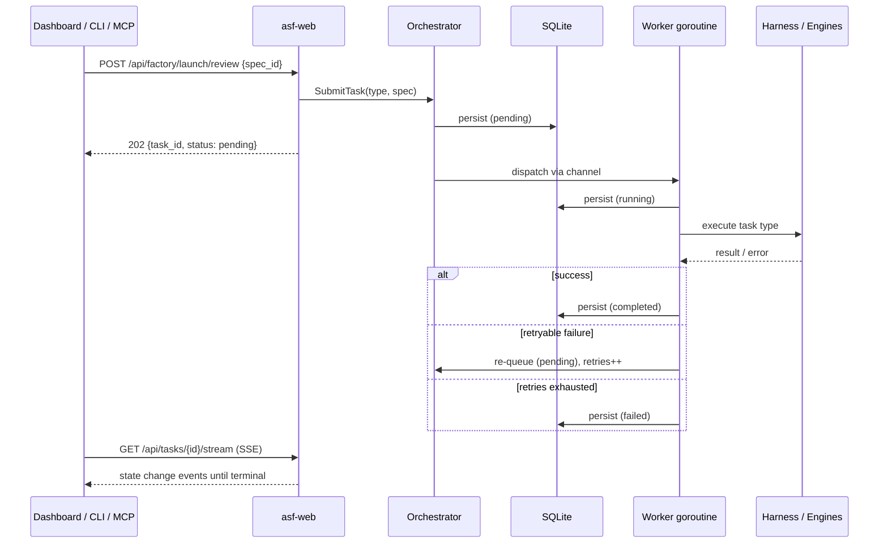
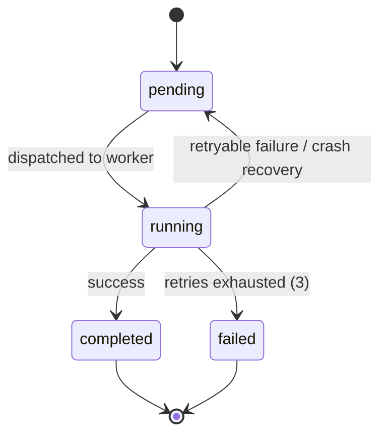

# Agentic Software Factory (Go)

A production-grade implementation of Agentic Software Engineering patterns in Go: a durable, observable orchestration system for running autonomous agent workloads across the software development lifecycle, with a CLI, an HTTP API, an MCP server, and a live Next.js dashboard.

**Design principles**

- **Specs over prompts** — work is defined by machine-readable YAML specifications (goals, constraints, success criteria, execution steps), not ad-hoc prompt strings.
- **Explicit state machines** — every lifecycle (tasks, workers, verification, integrations, UI buttons, dashboard connection) is a declared transition table, not scattered string comparisons. See [State Machines](#state-machines).
- **Durable by default** — tasks persist to SQLite; interrupted work is re-queued on restart (at-least-once semantics).
- **Verified, not vibed** — an AI-TDD loop runs build → test → lint → constraint checks and feeds structured errors back for retries.

---

> 📚 **Deeper, diagram-first documentation lives in [`docs/`](docs/README.md)** — [Architecture (visual walkthrough)](docs/ARCHITECTURE.md) · [Getting Started](docs/GETTING_STARTED.md) · [Configuration](docs/CONFIGURATION.md) · [API](docs/API.md) · [Security](docs/SECURITY.md) · [Development](docs/DEVELOPMENT.md) · [State Machines](docs/STATE_MACHINES.md)

## Table of Contents

1. [Architecture](#architecture)
2. [State Machines](#state-machines)
3. [Repository Layout](#repository-layout)
4. [Package Reference](#package-reference)
5. [Getting Started](#getting-started)
6. [CLI Reference (`asf`)](#cli-reference-asf)
7. [HTTP API Reference (`asf-web`)](#http-api-reference-asf-web)
8. [Web Dashboard](#web-dashboard)
9. [Specification Format](#specification-format)
10. [Factories-as-Code](#factories-as-code)
11. [Security Model](#security-model)
12. [Persistence & Durability](#persistence--durability)
13. [Verification Pipeline](#verification-pipeline)
14. [MCP Server](#mcp-server)
15. [Development Workflow](#development-workflow)
16. [Current Limitations](#current-limitations)

---

## Architecture

The factory is layered: access interfaces on top, orchestration in the middle, intelligence and execution engines below, SQLite at the bottom.



### Task execution sequence



---

## State Machines

Every lifecycle is declared once as a transition table in [`pkg/state`](pkg/state/state.go) and introspectable three ways:

| Surface | Command / URL | Audience |
|---|---|---|
| CLI | `./asf factory states [--json\|--markdown]` | humans, agents, CI |
| HTTP | `GET /api/state-machines` | dashboards, external agents |
| Docs | [`docs/STATE_MACHINES.md`](docs/STATE_MACHINES.md) (generated) | readers |

### Task lifecycle



Key property: a task is only ever *observed* as `failed` once its retries are exhausted — retryable failures re-queue directly to `pending`. `completed` and `failed` are the only terminal states, and consumers (SSE stream, MCP) use `TaskMachine.IsTerminal()` rather than hardcoding state names.

### Worker lifecycle

`idle → busy → idle`, with `error` reserved for fault states. Workers are **ephemeral**: they are recreated fresh on every boot (only tasks are durable). The pool auto-scales between 2 and `maxWorkers`: scale-up spawns a goroutine when all workers are busy; scale-down retires an idle worker by closing its stop channel.

### Verification pipeline

`build → test → lint → constraints → passed | failed` — the pipeline stops at the first failing phase and records `FailedPhase` in the result.

### UI machines (TypeScript mirror)

[`web-ui/src/lib/stateMachine.ts`](web-ui/src/lib/stateMachine.ts) mirrors the Go engine for React:

- **Launch buttons**: `idle → loading → success | error`, with timed auto-transitions (`success → idle` after 2.5 s, `error → idle` after 4 s) so buttons always recover.
- **Dashboard connection**: `connecting → live | unreachable`, with automatic reconnect.

Invalid transitions are rejected and logged in development instead of silently corrupting component state.

---

## Repository Layout

```
.
├── cmd/
│   ├── asf/            # CLI entrypoint (init, context, spec, verify, harness, factory, mcp)
│   └── asf-web/        # HTTP API server for the dashboard (launch, status, tasks, SSE)
├── pkg/
│   ├── state/          # Declarative FSM engine (the only package with no dependencies)
│   ├── context/        # Context engine: ADRs, specs, source → prioritized agent context
│   ├── spec/           # Specification engine: YAML/JSON specs, validation, prompt generation
│   ├── verify/         # Verification engine: build/test/lint/constraints pipeline
│   ├── harness/        # Complete harness: context + spec + verify retry loop
│   ├── factory/        # Orchestrator: worker pool, task queue, state machines, scaling
│   ├── persistence/    # SQLite store for tasks (and worker audit trail)
│   ├── mcp/            # Model Context Protocol server (JSON-RPC over HTTP)
│   ├── eval/           # LLM-as-a-judge evaluation + benchmark suite (needs an LLMClient)
│   ├── security/       # Docker sandbox config, input validation, RBAC
│   ├── factorydef/     # Factories-as-code: parse specs/factory.yaml
│   ├── integration/    # Slack / Teams / GitHub / Linear adapter scaffolding
│   └── conversation/   # Thread/message store
├── web-ui/             # Next.js 14 dashboard (Tailwind, App Router)
├── specs/              # Specification files (example.yaml) + factory.yaml
├── docs/               # ADRs + generated STATE_MACHINES.md
├── diagrams/           # Archify diagram sources
└── opentelemetry.go    # OTel tracing helpers (package otel)
```

---

## Package Reference

| Package | Exports worth knowing | Depends on |
|---|---|---|
| `pkg/state` | `State`, `Machine`, `NewMachine`, `Can/Validate/IsTerminal`, `Mermaid()`, `JSON()`, `Export()` | — |
| `pkg/context` | `ContextEngine.LoadContext`, `FormatForAgent`; priority: ADRs > specs > code; 50 KB/file cap | — |
| `pkg/spec` | `Specification`, `SpecEngine.LoadAllSpecs/ValidateSpec/GeneratePrompt`, `WriteSpecTemplate` | yaml.v3 |
| `pkg/verify` | `VerificationEngine.RunVerification`, `GenerateFixPrompt`, `PhaseMachine`, phase constants | state |
| `pkg/harness` | `CompleteHarness.Execute`, `ExecuteWithAgent(AgentClient)`, `AgentClient` interface | context, spec, verify |
| `pkg/factory` | `FactoryOrchestrator`, `Task`, `SubmitTask`, `GetTaskResult` (snapshot), `RecentTasks`, `GetFactoryStatus`, `TaskMachine`, `WorkerMachine`, `Machines()` | all engines, persistence, state |
| `pkg/persistence` | `PersistenceManager`, `TaskRecord`, `SaveTask`, `GetTasksByStatus` | mattn/go-sqlite3 |
| `pkg/mcp` | `MCPServer` — JSON-RPC methods + tools (see [MCP Server](#mcp-server)) | factory, factorydef |
| `pkg/eval` | `EvaluationEngine`, `LLMClient` interface, `BenchmarkSuite`, `DefaultEvaluationCriteria` | — |
| `pkg/security` | `SecurityEngine` (Docker sandbox), `InputValidator`, `RBACManager` | — |
| `pkg/factorydef` | `FactoryDefinition`, `LoadFactoryDefinition`, `FindFactoryDefinition` | yaml.v3 |
| `pkg/integration` | `Platform` constants, `ConnectionMachine`, adapters for Slack/Teams/GitHub/Linear | state |

---

## Getting Started

### Prerequisites

- **Go 1.23+** (module targets 1.26)
- **Node.js 18+** (dashboard)
- **Docker** (optional — only for sandboxed execution via `pkg/security`)
- **golangci-lint** (optional — the lint verification phase skips gracefully if absent)

### Build everything

```bash
# CLI
go build -o asf ./cmd/asf

# API server
go build -o asf-web-bin ./cmd/asf-web

# Dashboard dependencies
cd web-ui && npm install
```

### Run the full stack (two terminals)

```bash
# Terminal 1 — Go API server on :8080 (starts the factory + workers)
./asf-web-bin localhost:8080

# Terminal 2 — Next.js dashboard on :3000 (proxies /api/* to :8080)
cd web-ui && npm run dev
```

Open http://localhost:3000 — the Factory Status panel and Recent Activity feed are live; the LaunchPad cards submit real tasks.

### Smoke test from the shell

```bash
./asf spec list                      # should find spec-001
./asf verify                         # run build/test/lint on this repo
./asf factory states                 # print the state machines
curl -s localhost:8080/api/factory/status | jq
curl -s -X POST localhost:8080/api/factory/launch/review \
  -H 'Content-Type: application/json' -d '{"spec_id":"spec-001"}' | jq
```

---

## CLI Reference (`asf`)

| Command | What it does |
|---|---|
| `asf init` | Scaffold project structure (`docs/`, `specs/`, …) with an example spec + ADR |
| `asf context` | Load and print the agent context (ADRs, specs, source) with priorities and token estimates |
| `asf spec list` | List all specs in `specs/` |
| `asf spec load <id>` | Pretty-print one spec (intent, constraints, inputs, steps) |
| `asf spec validate <id>` | Validate required fields; non-zero exit on errors |
| `asf spec generate <id>` | Generate the agent prompt for a spec |
| `asf spec template [path]` | Write a new spec template |
| `asf verify` | Run the verification pipeline (build → test → lint) on the working directory |
| `asf harness run <spec-id>` | Full harness: validate spec, load context, build prompt, verify with retries |
| `asf factory start` | Start the orchestrator with 4 workers (foreground) |
| `asf factory status` | Print worker/task counters |
| `asf factory submit <type> <spec-id>` | Queue a task (`generate` \| `verify` \| `review` \| `refactor`) |
| `asf factory states [--json\|--markdown]` | Print all declared state machines (Mermaid, JSON, or Markdown doc) |
| `asf mcp start [addr]` | Start the MCP server (default `localhost:8080`) |

Regenerate the state machine doc after changing any machine:

```bash
./asf factory states --markdown > docs/STATE_MACHINES.md
```

---

## HTTP API Reference (`asf-web`)

All routes are JSON over HTTP, guarded by [`apiGuard`](#security-model). Base URL defaults to `localhost:8080`.

| Method | Path | Description |
|---|---|---|
| `GET` | `/api/factory/status` | Counters + per-worker snapshots (`workers[]` with id, status, current task) |
| `POST` | `/api/factory/launch/{action}` | Submit a task. Actions: `review`, `bugfix`, `feature`, `eval` (→ `evaluate`, judges the latest generate output), `refactor`, `migrate` (mapped to task types in `launchTaskTypes`). Body: `{"spec_id": "...", "priority": 1, "parameters": {}}`. Returns `202 {task_id, status}` |
| `GET` | `/api/tasks` | Recent tasks, newest first (snapshot views, max 20) |
| `GET` | `/api/tasks/{id}` | One task snapshot: status, `terminal` flag, retries, result, error, timestamps |
| `GET` | `/api/tasks/{id}/stream` | **Server-Sent Events**: emits a JSON event on every state change, closes when the task reaches a terminal state |
| `GET` | `/api/specs` | Launchable specs from `specs/` (`id`, `title`, `version`) |
| `GET` | `/api/agents` | Agents declared in `specs/factory.yaml` |
| `GET` | `/api/state-machines` | All state machine declarations (states, transitions, terminals) |
| `GET` | `/api/harness/status` | Harness readiness |

Example — follow a task to completion:

```bash
ID=$(curl -s -X POST localhost:8080/api/factory/launch/feature \
  -H 'Content-Type: application/json' -d '{"spec_id":"spec-001"}' | jq -r .task_id)
curl -N localhost:8080/api/tasks/$ID/stream   # SSE until terminal
```

---

## Web Dashboard

Next.js 14 (App Router) + Tailwind, in `web-ui/`. Everything on the page is live data:

- **LaunchPad** — six one-click launch cards. Each button is driven by the `launch` state machine (`idle → loading → success|error` with auto-reset). The spec selector is populated from `/api/specs`; stale `localStorage` selections are reset automatically.
- **Factory Status** — polls `/api/factory/status` every 3 s (instantly after a launch, via the `taskLaunched` DOM event). Shows the status pill (`Running` / `Connecting…` / `Unreachable` with a recovery hint), per-worker cards, queue depth, completed/failed counters.
- **Recent Activity** — polls `/api/tasks` and renders real task history: timestamps, status badges (one shared `statusBadge` map), human-readable messages including failure errors and retry counts.

**Dev proxy:** `next.config.js` rewrites `/api/*` → `http://localhost:8080` in development. In production the rewrite activates **only** when `ASF_API_URL` is set explicitly, so a deployed dashboard never silently exposes a localhost-only backend. `npm run dev` binds to `127.0.0.1`.

---

## Specification Format

Specs live in `specs/*.yaml` (JSON also accepted). Generate a starting point with `asf spec template`.

```yaml
id: "spec-001"               # unique id — how tasks reference this spec
version: "1.0"
title: "Example Specification"
description: "What this spec achieves"

intent:
  goal: "Clear, measurable goal for the agent"
  context: "Background and constraints"
  success_criteria:
    - "Measurable outcome 1"
  anti_goals:
    - "What to explicitly avoid"

constraints:                  # hard boundaries, typed
  - id: "c1"
    type: "must"              # must | must_not | should | should_not
    description: "Hard constraint the agent must follow"
    validator: "optional validation snippet"

inputs:
  input_name:
    type: "string"
    description: "..."
    required: true
    default: "value"

outputs:
  output_name:
    type: "string"
    description: "..."

steps:                        # execution plan with dependencies
  - id: "s1"
    name: "First step"
    description: "..."
    tool: "optional tool name"
    depends_on: []
```

`asf spec validate <id>` enforces: non-empty `id`, `title`, `intent.goal`, at least one success criterion, and well-formed constraints.

---

## Factories-as-Code

`specs/factory.yaml` declares the factory itself — agents, workflows, and sandbox runners:

```yaml
factory:
  name: "go-agentic-factory"
  version: "1.0"
  agents:
    - id: "gen-agent"
      role: "code-generator"
      capabilities: ["generate", "refactor"]
      model: "claude-sonnet-5"
  workflows:
    - id: "code-improvement"
      steps:
        - name: "generate-code"
          agent: "gen-agent"
        - name: "run-verification"
          agent: "verify-agent"
          validation: "harness"
  runners:
    - id: "default-sandbox"
      image: "golang:1.23-alpine"
      work_dir: "/workspace"
      timeout: "300s"
```

`factorydef.FindFactoryDefinition` discovers it; the MCP server and `/api/agents` expose its contents.

---

## Security Model

Both HTTP surfaces — the web API (`/api/*`) and the MCP server (`/mcp`) — share one guard (`pkg/webguard`), since both can submit credential-spending LLM tasks:

| Check | Defends against |
|---|---|
| `RemoteAddr` must be loopback | remote connections (the TCP peer cannot be spoofed by headers) |
| `Host` header must be loopback | DNS rebinding |
| `Origin` header (when present) must be loopback | CSRF from arbitrary websites |
| `Content-Type: application/json` required on mutating requests | HTML-form CSRF |
| Request bodies capped at 1 MiB | resource exhaustion |
| `ASF_API_TOKEN` env var (optional) | when set, every request must send `Authorization: Bearer <token>` — required for any non-local deployment (e.g. behind a reverse proxy) |

Task snapshots: `GetTaskResult`/`RecentTasks` return copies taken under the orchestrator lock, so API handlers never race with worker mutations.

LLM credential policy: an exported `ANTHROPIC_API_KEY`/`ANTHROPIC_AUTH_TOKEN` enables the LLM directly (an explicit act for this process), but an ambient `ant auth login` profile additionally requires `ASF_ENABLE_LLM=1` — the factory never silently spends credentials created for other tools. Concurrent paid calls are capped (`ASF_LLM_MAX_CONCURRENT`, default 2) independently of the worker pool.

---

## Persistence & Durability

- SQLite database at `.asf/factory.db` (gitignored), schema: `tasks` + `workers` tables.
- Every task state transition is persisted. On startup the orchestrator restores all tasks; tasks persisted as `running` were interrupted mid-execution and are **re-queued** (`running → pending`, the crash-recovery transition).
- This yields **at-least-once** execution: a task interrupted by a crash runs again, so task handlers should be idempotent.
- Workers are *not* restored — they are ephemeral and recreated each boot. Worker rows remain as an audit trail.

---

## Verification Pipeline

`pkg/verify` implements the AI-TDD loop used by `asf verify`, the harness, and `verify`-type tasks:

1. **build** — `go build ./...`, errors parsed into file/line/message
2. **test** — `go test -v ./...` with a 2-minute timeout
3. **lint** — `golangci-lint run` (skipped if not installed)
4. **constraints** — spec constraint checks (when a spec is provided)

The pipeline stops at the first failing phase; `VerificationResult` records `Phase`, `FailedPhase`, structured `Errors`, and outputs. `GenerateFixPrompt` turns failures into an agent-ready fix prompt — the feedback half of the retry loop in `harness.Execute` (max 3 attempts).

---

## MCP Server

`asf mcp start` serves the Model Context Protocol over HTTP at `/mcp` (JSON-RPC): methods `initialize`, `tools/list`, `tools/call`, `resources/list`, `resources/read`.

**Tools:** `submit_task`, `get_task_result`, `get_factory_status`, `list_specs`, `get_spec`, `list_agents`, `run_verification`
**Resources:** `factory://status`, `factory://specs`

This lets external agents (Claude Code, other MCP clients) drive the factory programmatically.

---

## Development Workflow

```bash
go build ./...                      # must stay green — the whole repo compiles
go vet ./...
go test ./...                       # pkg/state has the unit tests so far
cd web-ui && npx tsc --noEmit       # dashboard typecheck
```

Conventions:

- State strings persisted to SQLite / served over JSON are **frozen** — add states by extending the machines in `pkg/factory/states.go`, `pkg/verify`, `pkg/integration`, and mirror UI-facing ones in `web-ui/src/lib/stateMachine.ts`.
- After changing any machine, regenerate the doc: `./asf factory states --markdown > docs/STATE_MACHINES.md`.
- New API consumers should use the `terminal` field / `IsTerminal` rather than comparing status strings.
- Compiled binaries (`asf`, `asf-web-bin`) and runtime state (`.asf/`) are gitignored — don't commit them.

---

## Current Limitations

Honest notes on what is scaffolding versus production-ready:

- **The LLM is wired, provider-agnostic, and optional.** `pkg/llm` exposes a `Client` interface (satisfying `harness.AgentClient` and `eval.LLMClient`) with pluggable providers selected via `ASF_LLM_PROVIDER`: `anthropic` (official SDK; default model `claude-opus-4-8`), `openai`, `ollama` (zero config — defaults to `http://localhost:11434`, auto-picks the first installed chat model; override with `OLLAMA_HOST`/`ASF_MODEL`), or `openai-compatible` (any other Chat-Completions server — vLLM, Groq, Mistral, LM Studio — via `ASF_LLM_BASE_URL`; `ASF_LLM_API_KEY` optional). `ASF_MODEL` selects the model for any provider. Auto-detection order: Anthropic env credentials → OpenAI env credentials → a running local Ollama → `ant` profile (behind `ASF_ENABLE_LLM=1`). Without any, the factory runs in **prompt-only mode** — tasks complete with the assembled prompt as their result. Prompts carry a provider-aware project-context budget (`ASF_CONTEXT_MAX_CHARS`; ~24K chars for local models, ~400K for large-context cloud models) so small local context windows don't drown in prefill.

  Fastest local start: install [Ollama](https://ollama.com), `ollama pull granite4.1:3b` (or any chat model), then just run `go run ./cmd/asf-web` — the factory detects it automatically.
- **The evaluation engine is wired as the improvement loop.** Every LLM-backed `generate` task is judged by LLM-as-a-judge (`pkg/eval`, weighted criteria, 0.75 threshold); below-threshold output is regenerated with the judge's feedback (`ASF_EVAL_MAX_ATTEMPTS`, default 2), and the final verdict (score, per-criterion breakdown, feedback, improvements) is attached to the task result. A dedicated `evaluate` task type (the dashboard's "Run Benchmark" card) judges the latest completed generate output for a spec on demand.
- **Constraint verification** (`verifyConstraints`) is a stub.
- **Integration adapters** (Slack/Teams/GitHub/Linear) compile and model webhooks/connection state, but are not wired to live credentials.
- **OpenTelemetry** (`opentelemetry.go`) configures a tracer provider without an exporter — spans are sampled but dropped until OTLP wiring is added.
- **Evaluation engine** (`pkg/eval`) is ready but inert without an `LLMClient`.

The orchestration spine — durable queue, state machines, retry/crash recovery, HTTP/SSE/MCP surfaces, live dashboard — is real and tested end-to-end.

---

## License

MIT — see [LICENSE](LICENSE).
