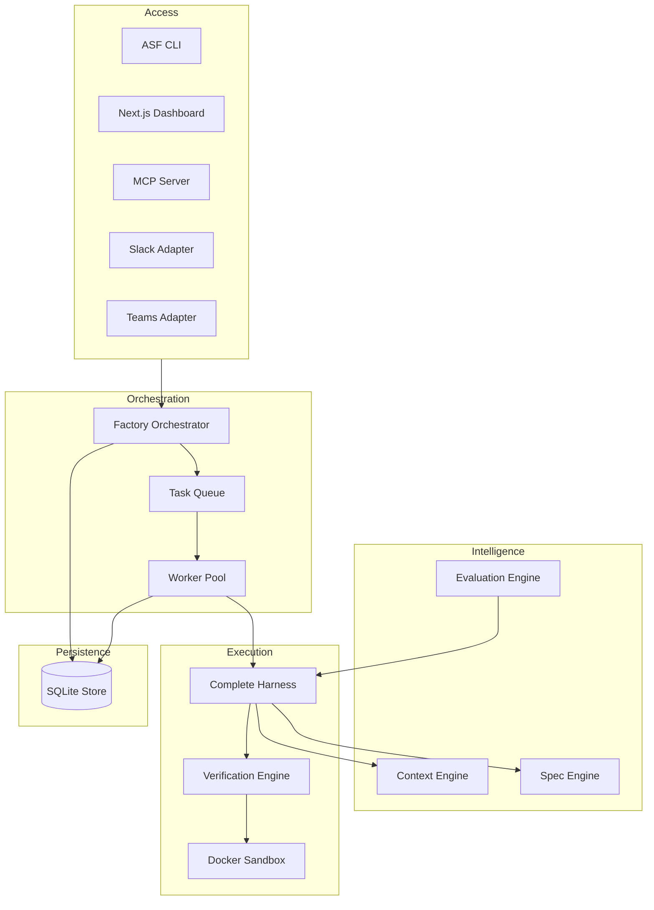
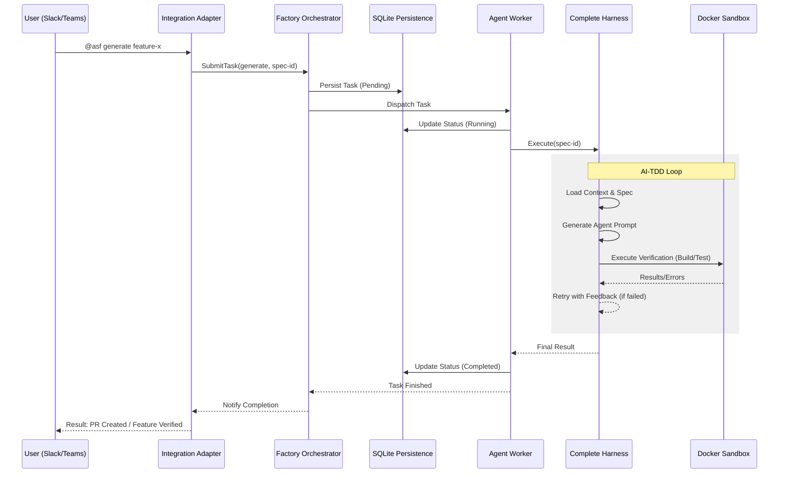
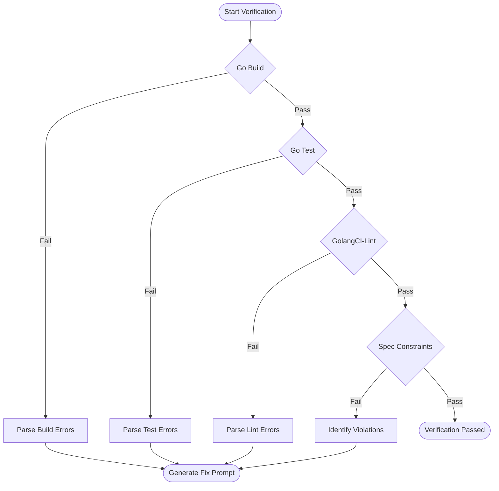

# Agentic Software Factory (Go Edition)

A production-grade implementation of Agentic Software Engineering patterns in the Go ecosystem. This factory implements a scalable, durable, and observable infrastructure for running autonomous agents across the software development lifecycle.

## 🏗️ Architecture: The Factory Stack

The implementation follows a layered architecture inspired by modern agentic infrastructure patterns:



---

## 🌊 Message Flow: Task Execution Sequence

This diagram explains how a task (e.g., code generation) flows from an external integration through the factory to completion.



---

## 🔄 Verification Flow: AI-TDD Loop

The verification engine handles multi-phase checks to ensure agent-generated code meets quality standards.



---

## 🚀 Core Components

### 1. **Factory Orchestrator** (`pkg/factory`)
Manages a pool of concurrent workers. It uses a durable task queue and auto-scales workers based on load.

### 2. **Context Engine** (`pkg/context`)
Curates project-specific context (ADRs, existing specs, source code) and handles token budgeting for LLM prompts.

### 3. **Specification Engineering** (`pkg/spec`)
Uses machine-readable YAML/JSON specifications to define goals, constraints, and execution plans for agents.

### 4. **Verification Engine** (`pkg/verify`)
Executes the AI-TDD loop, running builds, tests, and linters in isolated environments to provide concrete feedback to agents.

### 5. **Security Sandbox** (`pkg/security`)
Executes potentially unsafe agent commands inside Docker containers with resource limits and restricted network access.

### 6. **MCP Server** (`pkg/mcp`)
Exposes the factory's tools and resources via the Model Context Protocol, allowing external agents to interact with the factory.

### 7. **Integration Layer** (`pkg/integration`)
Headless adapters for Slack, Microsoft Teams, and GitHub, allowing teams to trigger factory tasks from their existing tools.

---

## 🛠️ Getting Started

### Prerequisites
- Go 1.23+
- Docker (for sandboxed execution)
- Node.js (for Web UI)

### Installation
```bash
# Build the ASF CLI
go build -o asf ./cmd/asf

# Install Web UI dependencies
cd web-ui && npm install
```

### Running the Factory
```bash
# Start the factory orchestrator
./asf factory start

# Start the MCP server
./asf mcp start

# Start the Web Dashboard
cd web-ui && npm run dev
```

### Submitting a Task
```bash
# Generate code from a specification
./asf factory submit generate spec-001

# Run verification manually
./asf verify
```

---

## 🎨 Web Dashboard
The Next.js dashboard follows the **Google UX style** (white background, clean typography) and provides a real-time view of:
- Factory status and worker activity
- Task queue and results
- Context and Specification browser
- Verification logs

---

## 🧪 Testing
Playwright tests are included to verify the end-to-end flow:
```bash
npx playwright test
```

---

## 📖 Related Patterns
This implementation maps to the **Warp Factory Stack**:
- **Factories-as-code**: `pkg/factorydef`
- **Orchestration**: `pkg/factory`
- **Improvement**: `pkg/eval` + `pkg/verify`
- **Compute**: `pkg/security`
- **Access**: `pkg/mcp` + `pkg/integration`
