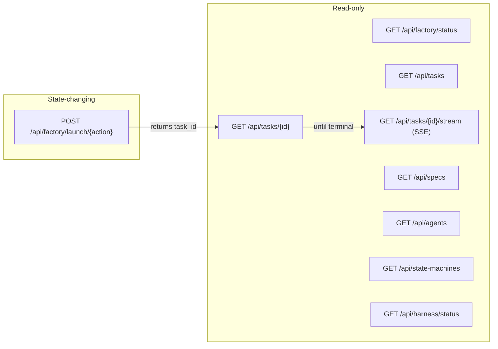
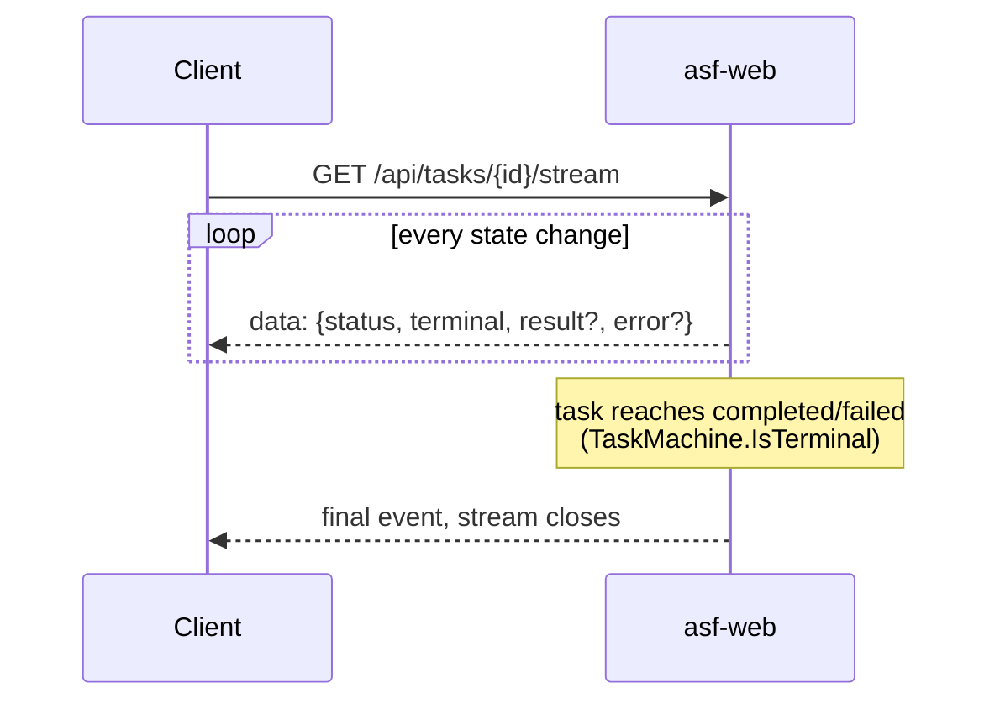

# HTTP API Reference

Served by `cmd/asf-web` (default `localhost:8080`). All routes are JSON; everything under `/api/` passes through the [security guard](SECURITY.md). The dashboard consumes exactly these endpoints through the Next.js dev proxy.

## Endpoint map



## Launch a task

`POST /api/factory/launch/{action}` — submits a task and returns its ID. Actions map to task types:

| Action | Task type | What it does |
|---|---|---|
| `feature`, `bugfix` | `generate` | Generate an artifact from the spec, judged by the improvement loop |
| `review` | `review` | LLM code review of the project context against the spec |
| `refactor`, `migrate` | `refactor` | Prioritized refactoring plan |
| `eval` | `evaluate` | Judge the **latest completed generate output** for the spec |

```bash
curl -s -X POST localhost:8080/api/factory/launch/feature \
  -H 'Content-Type: application/json' \
  -d '{"spec_id": "spec-001", "priority": 1}'
```

```json
{ "task_id": "40d3d80b-…", "status": "pending", "action": "feature", "type": "generate" }
```

Errors: `400` missing/invalid body or `spec_id`, `404` unknown action, `415` wrong Content-Type, `503` queue full.

## Read a task

`GET /api/tasks/{id}` — snapshot at any point in the lifecycle (tasks are visible from the moment of submission):

```json
{
  "id": "40d3d80b-…",
  "type": "generate",
  "spec_id": "spec-001",
  "status": "completed",
  "terminal": true,
  "retries": 0,
  "created_at": "2026-11-15T12:32:20+05:30",
  "completed_at": "2026-11-15T13:28:47+05:30",
  "error": "",
  "result": {
    "output": "…the generated artifact…",
    "model": "granite4.1:3b",
    "attempts": 1,
    "context_items": 42,
    "evaluation": {
      "score": 0.9,
      "passed": true,
      "criteria": { "correctness": 0.95, "code_quality": 0.9, "…": 0 },
      "feedback": "…judge's reasoning…",
      "improvements": ["…"]
    }
  }
}
```

`terminal` comes from the task state machine (`TaskMachine.IsTerminal`) — rely on it rather than comparing status strings.

## Follow a task live (SSE)

`GET /api/tasks/{id}/stream` — one event per **state change**, stream closes at a terminal state:

```bash
curl -N localhost:8080/api/tasks/$ID/stream
```

```
data: {"id":"…","status":"running","terminal":false,…}

data: {"id":"…","status":"completed","terminal":true,"result":{…}}
```



## List recent tasks

`GET /api/tasks` — the 20 most recent tasks, newest first (powers the dashboard's Recent Activity feed):

```json
{ "tasks": [ { "id": "…", "type": "generate", "status": "completed", "…": "…" } ] }
```

## Factory status

`GET /api/factory/status` — live counters, per-worker snapshots, and LLM mode (powers the Factory Status panel):

```json
{
  "workers_total": 2, "workers_busy": 0, "workers_idle": 2,
  "workers": [ { "id": "worker-0", "status": "idle" } ],
  "tasks_pending": 0, "tasks_completed": 5, "tasks_failed": 1,
  "max_workers": 4,
  "llm_enabled": true, "llm_provider": "ollama", "llm_model": "granite4.1:3b"
}
```

## Specs, agents, state machines

| Endpoint | Returns |
|---|---|
| `GET /api/specs` | Launchable spec files on disk: `[{id, title, version}]` |
| `GET /api/agents` | Agents declared in `specs/factory.yaml` |
| `GET /api/state-machines` | Every state-machine declaration (states, transitions, terminals) — lets clients derive lifecycles instead of hardcoding them |
| `GET /api/harness/status` | `{"status": "ready"}` |

## MCP server

`asf mcp start [addr]` serves JSON-RPC at `/mcp` (same guard as the web API). Tools: `submit_task`, `get_task_result`, `get_factory_status`, `list_specs`, `get_spec`, `list_agents`, `run_verification`.

```bash
curl -s -X POST localhost:8080/mcp -H 'Content-Type: application/json' -d '{
  "jsonrpc": "2.0", "id": 1, "method": "tools/call",
  "params": {"name": "submit_task", "arguments": {"type": "generate", "spec_id": "spec-001"}}
}'
```

## Authentication

Local loopback callers need nothing. Remote deployments set `ASF_API_TOKEN` and send `Authorization: Bearer <token>` on every request — see [SECURITY.md](SECURITY.md) for the full rule set (loopback checks, Origin validation, Content-Type enforcement, body caps).
