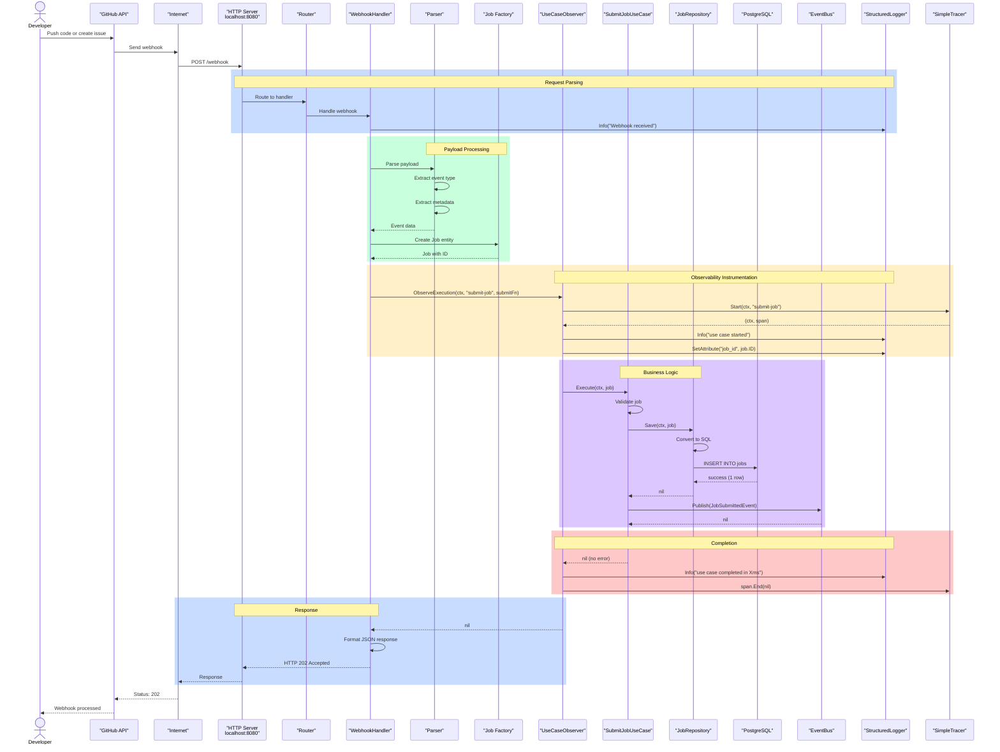
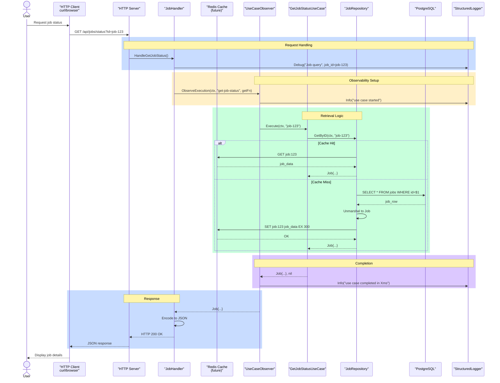
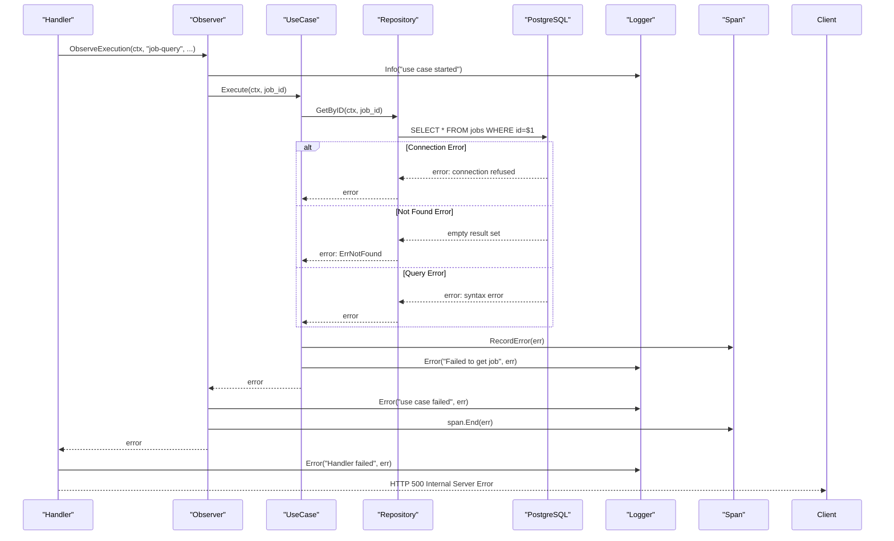
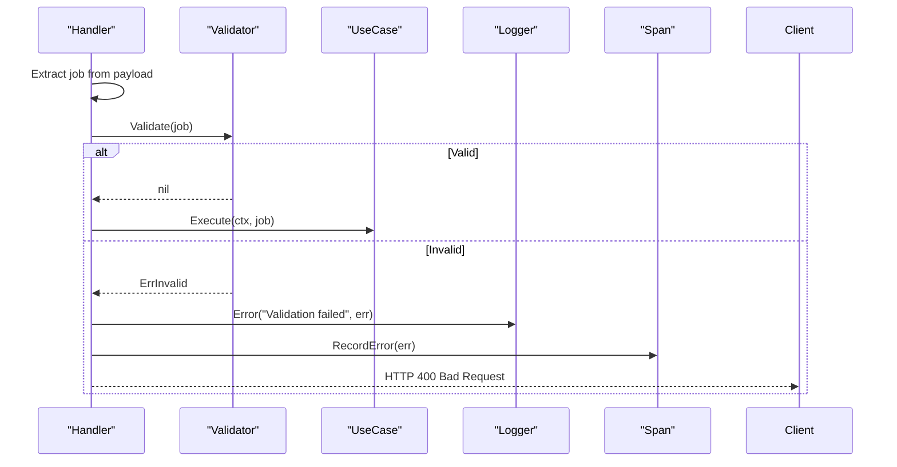
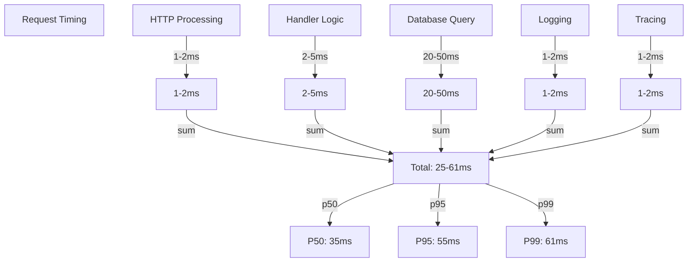
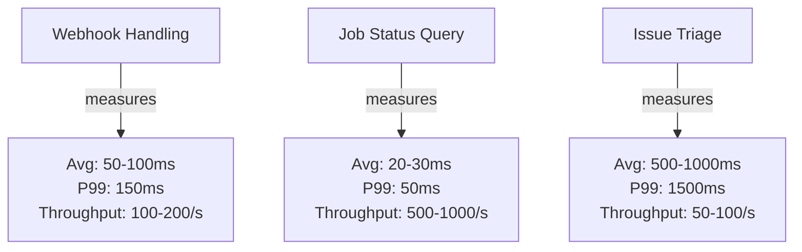
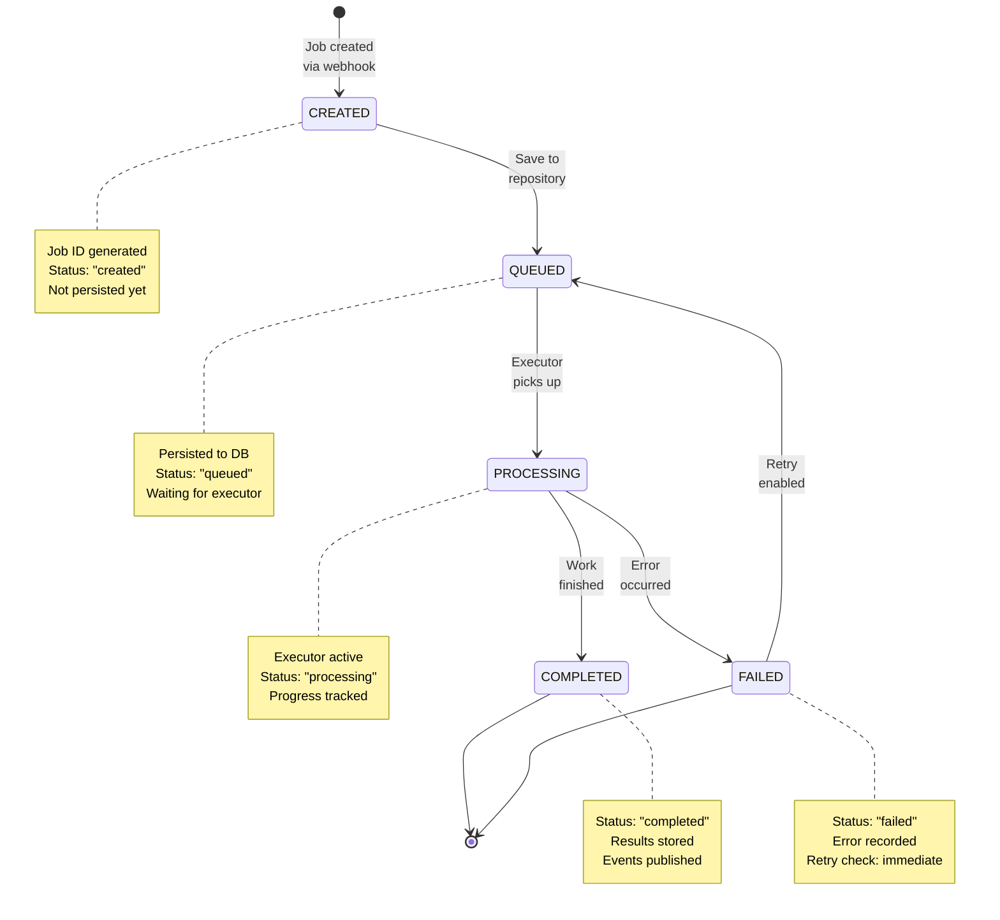
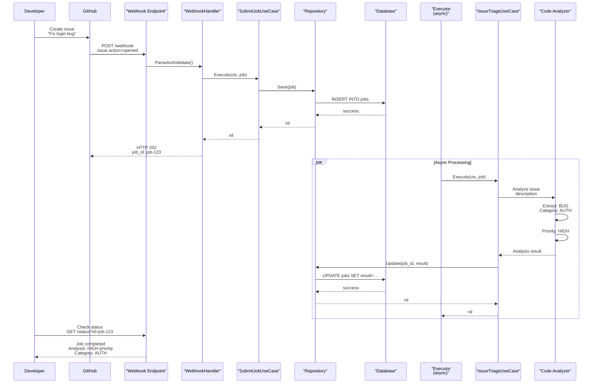

# API Flows & Sequence Diagrams

Comprehensive documentation of API flows with detailed sequence diagrams for all major operations.

## Table of Contents

1. [Webhook Processing](#webhook-processing)
2. [Job Status Query](#job-status-query)
3. [Error Scenarios](#error-scenarios)
4. [Concurrent Requests](#concurrent-requests)
5. [Performance Metrics](#performance-metrics)

---

## Webhook Processing

### GitHub Webhook to Job Creation - Full Flow



### Request-Response Bodies

**Request**:
```json
POST /webhook
Content-Type: application/json
X-GitHub-Event: issues
X-Hub-Signature: sha256=...

{
  "action": "opened",
  "issue": {
    "number": 123,
    "title": "Fix authentication bug",
    "body": "Users cannot login with OAuth",
    "user": {"login": "developer"}
  },
  "repository": {
    "name": "myrepo",
    "full_name": "myorg/myrepo",
    "url": "https://github.com/myorg/myrepo"
  }
}
```

**Response**:
```json
HTTP/1.1 202 Accepted
Content-Type: application/json

{
  "status": "accepted",
  "job_id": "job-1794942593078122000",
  "job_type": "issue-triage",
  "message": "Job submitted successfully"
}
```

**Console Output**:
```
2026-11-18 00:39:53 [INFO] Webhook received | event_type=issues action=opened
2026-11-18 00:39:53 [INFO] use case started | operation=submit-job job_id=job-1794942593078122000 job_type=issue-triage
2026-11-18 00:39:53 [INFO] job submitted | id=job-1794942593078122000 type=issue-triage
2026-11-18 00:39:53 [INFO] use case completed in 5ms | operation=submit-job
```

---

## Job Status Query

### Status Query with Caching (Future)



### Response Format

```json
HTTP/1.1 200 OK
Content-Type: application/json

{
  "id": "job-1794942593078122000",
  "type": "issue-triage",
  "status": "completed",
  "priority": 5,
  "input": {
    "action": "opened",
    "issue": 123,
    "repo": "myorg/myrepo",
    "title": "Fix authentication",
    "body": "..."
  },
  "result": {
    "issues_found": 2,
    "recommendations": ["Check error handling", "Add logging"]
  },
  "created_at": "2026-11-18T00:39:53Z",
  "updated_at": "2026-11-18T00:40:00Z"
}
```

---

## Error Scenarios

### Database Error Handling



### Validation Error Flow



---

## Concurrent Requests

### Multiple Webhooks Processing

```mermaid
graph TB
    WH1["Webhook 1<br/>Issue opened"]
    WH2["Webhook 2<br/>PR created"]
    WH3["Webhook 3<br/>Code pushed"]
    
    SERVER["HTTP Server<br/>(Goroutine pool)"]
    
    H1["Handler 1"]
    H2["Handler 2"]
    H3["Handler 3"]
    
    UC1["UseCase 1"]
    UC2["UseCase 2"]
    UC3["UseCase 3"]
    
    DB[(("PostgreSQL<br/>Connection Pool"))]
    
    LOG["Logger<br/>(Threadsafe)"]
    TRACE["Tracer<br/>(Threadsafe)"]
    
    WH1 -->|concurrent| SERVER
    WH2 -->|concurrent| SERVER
    WH3 -->|concurrent| SERVER
    
    SERVER -->|route| H1
    SERVER -->|route| H2
    SERVER -->|route| H3
    
    H1 -->|execute| UC1
    H2 -->|execute| UC2
    H3 -->|execute| UC3
    
    UC1 -->|query| DB
    UC2 -->|query| DB
    UC3 -->|query| DB
    
    H1 -->|log| LOG
    H2 -->|log| LOG
    H3 -->|log| LOG
    
    H1 -->|trace| TRACE
    H2 -->|trace| TRACE
    H3 -->|trace| TRACE
```

### Log Output with Concurrent Requests

```
[00:39:53.001] [INFO] use case started | operation=submit-job job_id=job-1 goroutine=12
[00:39:53.002] [INFO] use case started | operation=submit-job job_id=job-2 goroutine=13
[00:39:53.003] [INFO] use case started | operation=submit-job job_id=job-3 goroutine=14
[00:39:53.010] [INFO] use case completed in 9ms | operation=submit-job job_id=job-1
[00:39:53.011] [INFO] use case completed in 9ms | operation=submit-job job_id=job-2
[00:39:53.012] [INFO] use case completed in 9ms | operation=submit-job job_id=job-3
```

---

## Performance Metrics

### End-to-End Latency Distribution



### Operation Benchmarks



---

## State Transitions

### Job Status State Machine



---

## Example Workflow: Complete Issue Triage

### Step-by-Step Sequence



---

## Configuration & Tuning

### Performance Tuning Parameters

```yaml
# database.yaml
database:
  connection_pool:
    min_idle: 2
    max_size: 10
    timeout: 10s
    max_lifetime: 30m

# server.yaml
server:
  max_goroutines: 1000
  request_timeout: 30s
  read_timeout: 15s
  write_timeout: 15s
  
# logging.yaml
logging:
  level: info           # Can be debug, info, warn, error
  buffer_size: 10000
  flush_interval: 100ms
  
# tracing.yaml
tracing:
  enabled: true
  sample_rate: 1.0      # 100% sampling, reduce for high-volume
  batch_size: 100
  export_interval: 5s
```

---

## Monitoring & Observability

### Key Metrics to Monitor

```
Latency Metrics:
├─ webhook_latency_p50
├─ webhook_latency_p99
├─ job_query_latency_p50
└─ job_query_latency_p99

Throughput Metrics:
├─ webhooks_per_second
├─ queries_per_second
└─ completed_jobs_per_second

Error Metrics:
├─ webhook_errors_total
├─ database_errors_total
├─ validation_errors_total
└─ retry_count

Resource Metrics:
├─ memory_usage_bytes
├─ goroutine_count
├─ database_connections
└─ connection_pool_wait_time
```

### Logging Checklist

✅ All requests logged with request ID  
✅ Database queries logged with duration  
✅ Errors logged with full context  
✅ Span duration tracked and logged  
✅ Concurrent requests identified by goroutine ID  
✅ Sensitive data redacted (tokens, emails)  
✅ Structured fields for all events  

---

## References

- [Observability Guide](./OBSERVABILITY_GUIDE.md)
- [Clean Architecture Summary](./CLEAN_ARCHITECTURE_SUMMARY.md)
- [Main README](../README.md)
- [Detailed README](../README_DETAILED.md)
