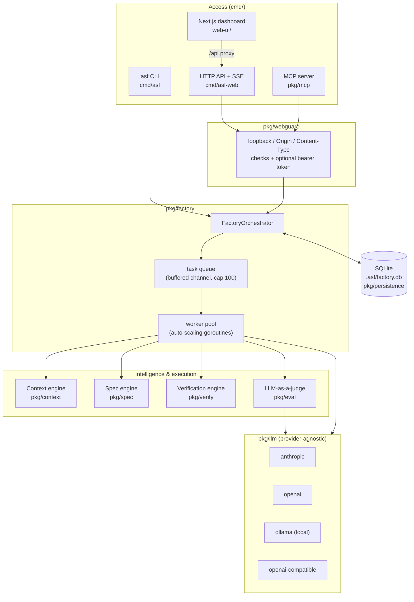
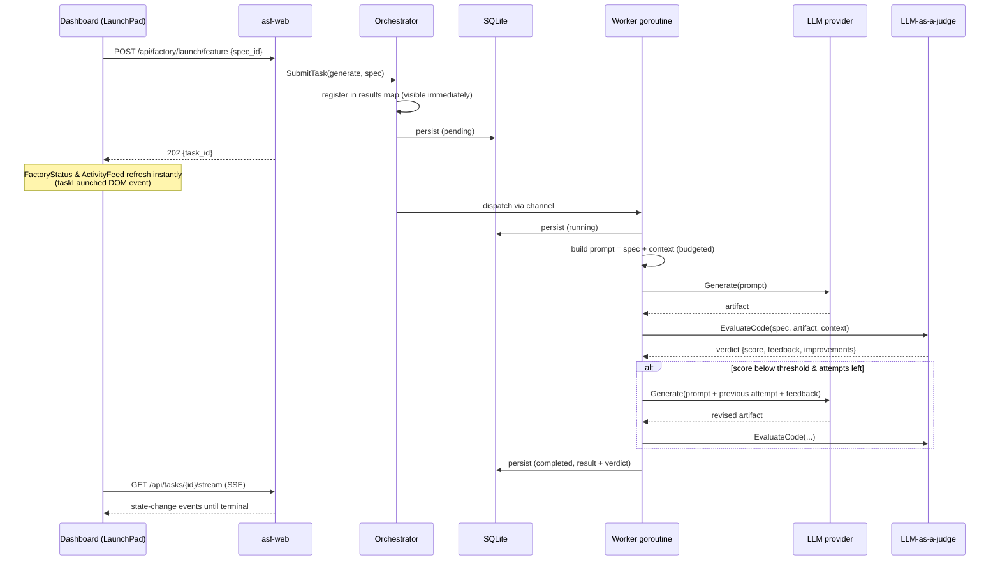
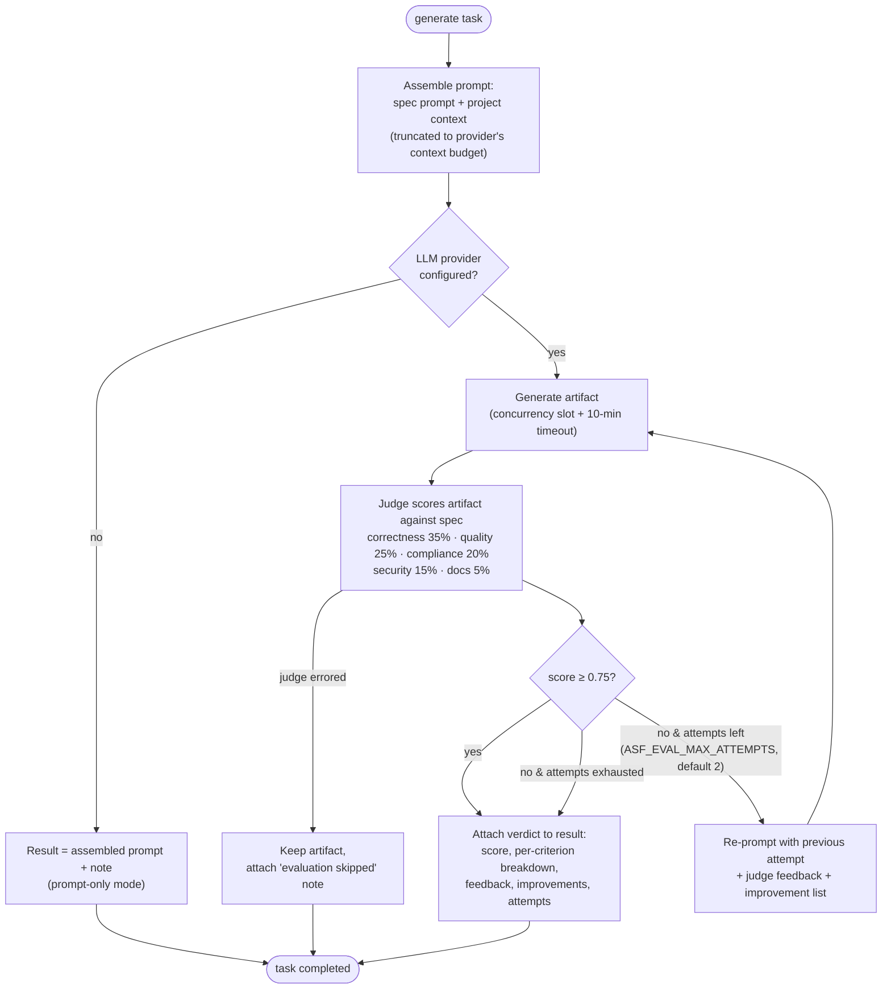
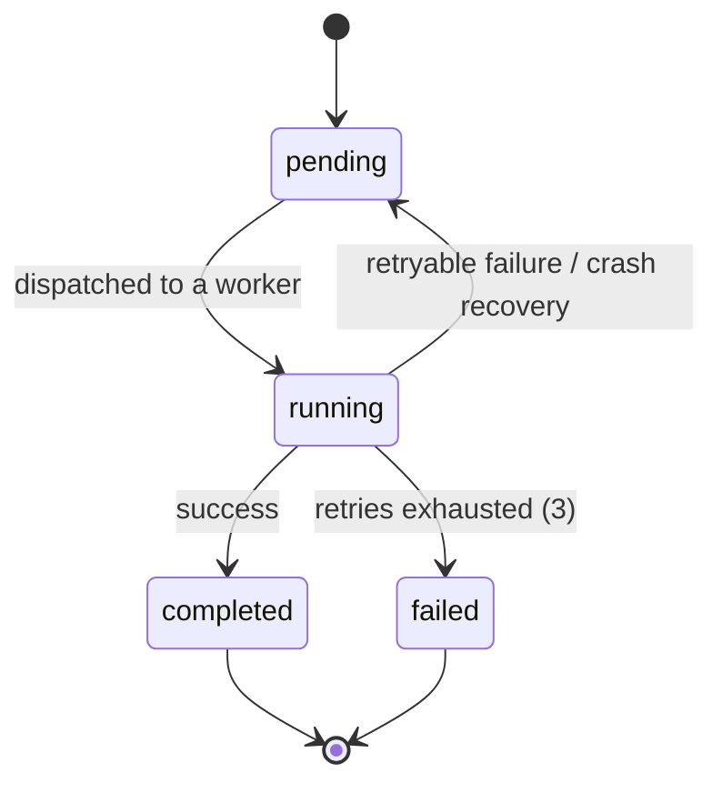
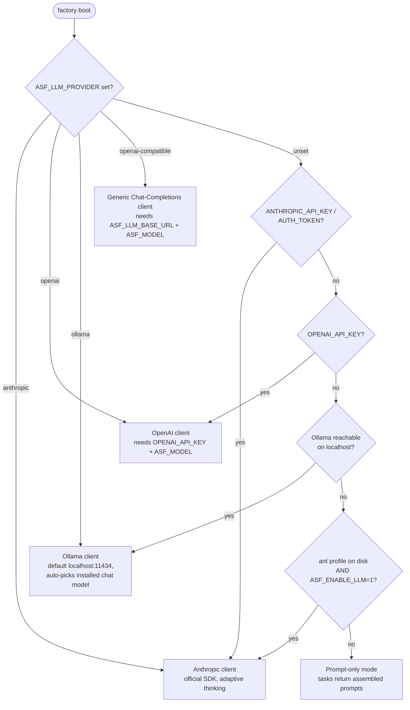
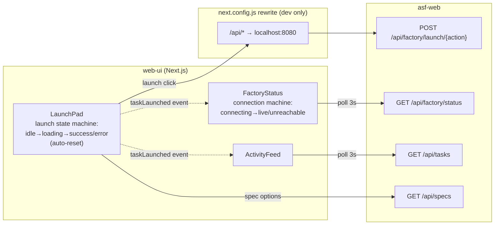

# Architecture

A visual walkthrough of the Agentic Software Factory. Every diagram reflects the actual code — file references point at the implementation.

## The big picture

Four layers: access surfaces on top, the orchestrator in the middle, the intelligence/execution engines below it, and durable state at the bottom. The LLM provider layer plugs into the side — everything works without it (prompt-only mode).



## How a task executes

The full round trip from a dashboard click to a judged artifact. The same flow serves the CLI (`asf factory submit`) and MCP (`submit_task`) — they just enter at `SubmitTask`.



## The improvement loop

What happens inside a `generate` task (`pkg/factory` → `executeGenerate`). The judge never discards a produced artifact — a broken judge degrades to a note, not a failure.



## Task lifecycle (explicit state machine)

Declared in `pkg/factory/states.go`; every state name below is the exact string persisted to SQLite and served over JSON. `completed` and `failed` are the only terminal states — consumers use `TaskMachine.IsTerminal()`, never hardcoded comparisons. See [STATE_MACHINES.md](STATE_MACHINES.md) for all machines (regenerate with `asf factory states --markdown`).



## Durability and crash recovery

Tasks are the durable unit; workers are ephemeral and rebuilt each boot. A crash mid-task re-queues the work — at-least-once semantics, so task handlers should be idempotent.

```mermaid
sequenceDiagram
    participant P1 as Process (before crash)
    participant DB as SQLite
    participant P2 as Process (after restart)

    P1->>DB: task persisted as "running"
    Note over P1: 💥 crash / restart
    P2->>DB: restore all tasks on boot
    DB-->>P2: task still "running"
    P2->>P2: explicit transition running → pending<br/>(the crash-recovery edge of TaskMachine)
    P2->>P2: re-queue task
    Note over P2: workers recreated fresh (always idle);<br/>only tasks survive restarts
```

## Provider selection

How `pkg/llm.FromEnv()` decides what powers the factory. A locally running Ollama is free, so it is safe to auto-enable; an ambient `ant auth login` profile spends real credits, so it sits behind an explicit opt-in.



## Dashboard data flow

Everything on the page is live; nothing is hardcoded. Components poll every 3 s and refresh instantly when a launch happens (via the `taskLaunched` DOM event).



## Where to go deeper

| Topic | Document |
|---|---|
| Install & first run | [GETTING_STARTED.md](GETTING_STARTED.md) |
| Every environment variable | [CONFIGURATION.md](CONFIGURATION.md) |
| HTTP API with examples | [API.md](API.md) |
| Threat model & guards | [SECURITY.md](SECURITY.md) |
| Contributing & conventions | [DEVELOPMENT.md](DEVELOPMENT.md) |
| All state machines (generated) | [STATE_MACHINES.md](STATE_MACHINES.md) |
