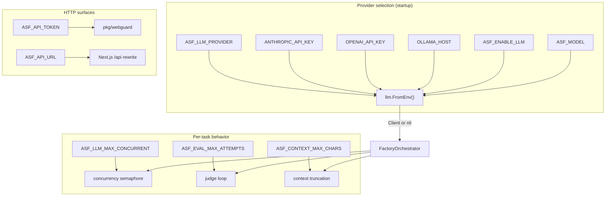

# Configuration Reference

Every environment variable the factory reads, grouped by concern. Nothing is required — with zero configuration the factory runs in prompt-only mode.

## LLM provider selection

Read by `pkg/llm` at factory startup. See the [provider-selection flowchart](ARCHITECTURE.md#provider-selection).

| Variable | Default | Meaning |
|---|---|---|
| `ASF_LLM_PROVIDER` | *(auto-detect)* | `anthropic`, `openai`, `ollama`, or `openai-compatible`. Unset = auto-detect: Anthropic env creds → OpenAI env creds → running local Ollama → `ant` profile (behind opt-in). |
| `ASF_MODEL` | provider-dependent | Model ID for any provider. Anthropic defaults to `claude-opus-4-8`; Ollama auto-picks the first installed chat model; `openai`/`openai-compatible` **require** it. |
| `ANTHROPIC_API_KEY` | — | Anthropic credential. Setting it is an explicit act — enables the LLM directly. |
| `ANTHROPIC_AUTH_TOKEN` | — | Alternative Anthropic credential (OAuth bearer). |
| `ANTHROPIC_CONFIG_DIR` | `~/.config/anthropic` | Where `ant auth login` profiles are looked up. |
| `ASF_ENABLE_LLM` | — | Set `1` to allow spending an **ambient** `ant auth login` profile. Not needed when an env credential is exported. |
| `OPENAI_API_KEY` | — | OpenAI credential. |
| `OLLAMA_HOST` | `http://localhost:11434` | Ollama server (scheme optional — `host:port` works). |
| `ASF_LLM_BASE_URL` | — | Base URL for `openai-compatible` (the `/v1` root); also overrides the Ollama URL. |
| `ASF_LLM_API_KEY` | — | Bearer key for `openai-compatible` servers that need one (local servers usually don't). |

Misconfiguration is never silent: the factory logs the specific problem at startup, e.g.

```
factory: running in prompt-only mode — ollama is not reachable at http://localhost:11434 — start it with `ollama serve` ...
factory: running in prompt-only mode — the openai provider requires ASF_MODEL (no default model is assumed)
```

## LLM behavior

| Variable | Default | Meaning |
|---|---|---|
| `ASF_LLM_MAX_CONCURRENT` | `2` | Cap on simultaneous paid LLM calls (semaphore), independent of worker-pool size. |
| `ASF_EVAL_MAX_ATTEMPTS` | `2` | Generate attempts in the judge loop: one generation plus revisions driven by judge feedback. `1` disables revision (generate + single judge pass). |
| `ASF_CONTEXT_MAX_CHARS` | `24000` local / `400000` cloud | Max characters of project context per prompt. Local providers (`ollama`, `openai-compatible`) default low because oversized prompts mean minutes of prefill on small models; large-context cloud models default high. Truncation is marked in the prompt. |

## Security

Details and rationale in [SECURITY.md](SECURITY.md).

| Variable | Default | Meaning |
|---|---|---|
| `ASF_API_TOKEN` | — | When set, **every** request to `/api/*` (asf-web) and `/mcp` (MCP server) must send `Authorization: Bearer <token>`; the loopback-only restriction is lifted. Required for any non-local deployment. |

## Dashboard (web-ui)

| Variable | Default | Meaning |
|---|---|---|
| `ASF_API_URL` | dev: `http://localhost:8080`; prod: *(unset = proxy disabled)* | Target of the Next.js `/api/*` rewrite. In production the proxy activates **only** when this is set explicitly, so a deployed dashboard never silently exposes a localhost-only backend. |

## How the pieces interact



## Common recipes

```bash
# Fully local, free, zero config (Ollama already running)
./asf-web-bin localhost:8080

# Local but pinned to a fast small model, single judge pass
ASF_MODEL=granite4.1:3b ASF_EVAL_MAX_ATTEMPTS=1 ./asf-web-bin localhost:8080

# Anthropic with a bigger context budget and more parallelism
export ANTHROPIC_API_KEY=sk-ant-...
ASF_LLM_MAX_CONCURRENT=4 ./asf-web-bin localhost:8080

# Remote deployment behind a reverse proxy (token required)
ASF_API_TOKEN=$(openssl rand -hex 24) ./asf-web-bin 0.0.0.0:8080
```
