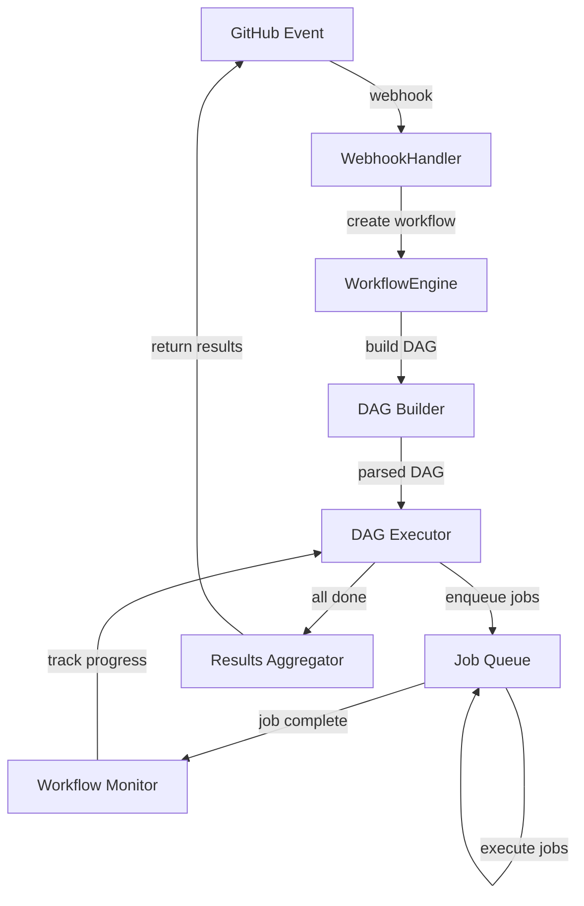
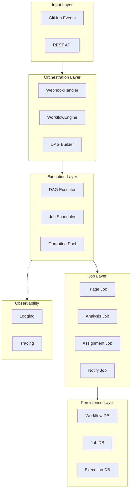
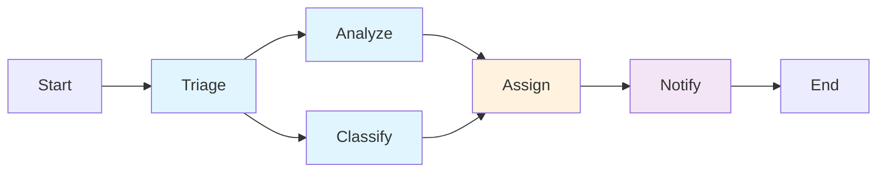
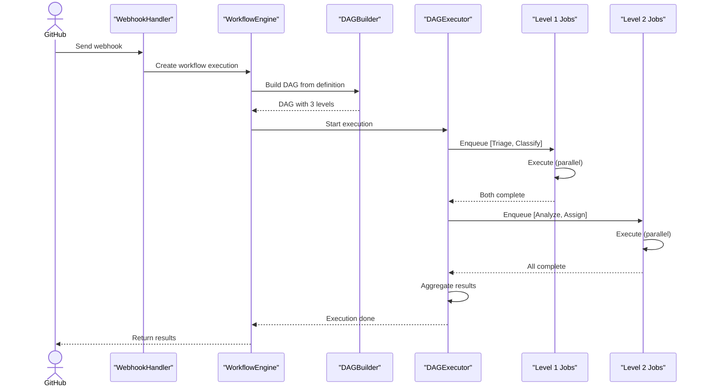

# DAG-Based Workflow Engine Design

A comprehensive guide to implementing a Directed Acyclic Graph (DAG) workflow engine for complex job orchestration.

---

## Vision: From Linear to Orchestrated

### Current (Linear)
```
GitHub Issue → Triage Job → Done
```

### With DAG Engine
```
GitHub Issue
  ├─ Triage Job
  │  ├─ Analysis Job (depends on Triage)
  │  └─ Assignment Job (depends on Triage)
  │     ├─ Notify Team
  │     └─ Create PR
  └─ Label Classifier (parallel with Triage)
```

---

## Architecture Overview

### DAG Component Integration



### Full System Architecture with DAG



---

## Core Concepts

### 1. Workflow Definition (YAML)

```yaml
name: "GitHub Issue Workflow"
version: "1.0"
description: "Complete workflow for handling GitHub issues"

on:
  github_event:
    type: "issues"
    action: "opened"

jobs:
  triage:
    task: "issue-triage"
    input:
      issue_number: "{{ github.issue.number }}"
      repo: "{{ github.repository }}"
    
  analyze:
    task: "code-analysis"
    depends_on: ["triage"]
    input:
      triage_result: "{{ jobs.triage.output }}"
    
  classify:
    task: "label-classifier"
    depends_on: ["triage"]
    input:
      issue_body: "{{ github.issue.body }}"
    
  assign:
    task: "auto-assign"
    depends_on: ["analyze", "classify"]
    input:
      analysis: "{{ jobs.analyze.output }}"
      labels: "{{ jobs.classify.output }}"
    
  notify:
    task: "notify-team"
    depends_on: ["assign"]
    input:
      assigned_to: "{{ jobs.assign.output.assignee }}"
      issue_url: "{{ github.issue.html_url }}"
```

### 2. DAG Structure (In-Memory)



---

## Data Models

### Workflow Entity

```go
type Workflow struct {
    ID              string              // UUID
    Name            string              // "GitHub Issue Workflow"
    Version         string              // "1.0"
    Definition      WorkflowDefinition  // YAML parsed
    Triggers        []Trigger           // What triggers this workflow
    Status          WorkflowStatus      // created/running/completed/failed
    CreatedAt       time.Time
    UpdatedAt       time.Time
    CompletedAt     *time.Time
}

type WorkflowStatus string
const (
    WorkflowCreated   WorkflowStatus = "created"
    WorkflowRunning   WorkflowStatus = "running"
    WorkflowCompleted WorkflowStatus = "completed"
    WorkflowFailed    WorkflowStatus = "failed"
)
```

### WorkflowExecution (Instance)

```go
type WorkflowExecution struct {
    ID              string                      // UUID
    WorkflowID      string                      // Reference to workflow definition
    TriggerEvent    TriggerEvent                // What triggered this execution
    DAG             DirectedAcyclicGraph        // Parsed DAG for this run
    JobExecutions   map[string]*JobExecution    // Job ID → execution
    Status          WorkflowExecutionStatus     // pending/running/completed/failed
    Progress        WorkflowProgress            // Track completion %
    StartedAt       time.Time
    CompletedAt     *time.Time
    Results         map[string]interface{}      // Job results
}

type WorkflowProgress struct {
    TotalJobs      int       // 5
    CompletedJobs  int       // 3
    FailedJobs     int       // 0
    PercentComplete float64  // 60%
}
```

### DAG Representation

```go
type DirectedAcyclicGraph struct {
    Nodes map[string]*DAGNode        // Job ID → node
    Edges map[string][]string        // Job ID → dependent jobs
    Levels [][]string                // Execution levels for topological sort
}

type DAGNode struct {
    JobID           string
    TaskName        string
    DependsOn       []string        // Jobs this depends on
    Input           map[string]interface{}
    Status          JobExecutionStatus
    StartedAt       *time.Time
    CompletedAt     *time.Time
    Result          interface{}
    Error           *string
}

type JobExecutionStatus string
const (
    JobPending    JobExecutionStatus = "pending"
    JobRunning    JobExecutionStatus = "running"
    JobCompleted  JobExecutionStatus = "completed"
    JobFailed     JobExecutionStatus = "failed"
)
```

---

## Execution Flow

### Step-by-Step Execution



### Execution Levels (Topological Sort)

```
Level 0: [Triage, Classify]      → Can run in parallel
         ↓↓
Level 1: [Analyze, Assign]       → Can run in parallel (depends on Level 0)
         ↓↓
Level 2: [Notify]                → Runs after Level 1
         ↓
Level 3: [Complete]              → Final step
```

---

## Implementation Components

### 1. DAG Builder (Parse YAML → DAG)

```go
type DAGBuilder struct {
    validator *WorkflowValidator
}

func (b *DAGBuilder) Build(def WorkflowDefinition) (*DirectedAcyclicGraph, error) {
    // 1. Validate no cycles (DFS)
    if err := b.detectCycles(def.Jobs); err != nil {
        return nil, fmt.Errorf("cycle detected: %w", err)
    }
    
    // 2. Build dependency graph
    nodes := make(map[string]*DAGNode)
    edges := make(map[string][]string)
    
    for jobID, job := range def.Jobs {
        nodes[jobID] = &DAGNode{
            JobID: jobID,
            TaskName: job.Task,
            DependsOn: job.DependsOn,
            Input: job.Input,
        }
        edges[jobID] = job.DependsOn
    }
    
    // 3. Topological sort into execution levels
    levels := b.topologicalSort(edges)
    
    return &DirectedAcyclicGraph{
        Nodes: nodes,
        Edges: edges,
        Levels: levels,
    }, nil
}
```

### 2. DAG Executor (Execute DAG Level-by-Level)

```go
type DAGExecutor struct {
    jobFactory   JobFactory
    logger       Logger
    tracer       TraceProvider
    maxParallel  int
}

func (e *DAGExecutor) Execute(ctx context.Context, dag *DirectedAcyclicGraph) error {
    // For each level
    for _, level := range dag.Levels {
        // Execute all jobs in this level in parallel
        results := make(map[string]interface{})
        errors := make(map[string]error)
        
        wg := sync.WaitGroup{}
        for _, jobID := range level {
            wg.Add(1)
            go func(id string) {
                defer wg.Done()
                
                node := dag.Nodes[id]
                
                // 1. Wait for dependencies (from previous levels)
                for _, dep := range node.DependsOn {
                    if depErr, exists := errors[dep]; exists && depErr != nil {
                        errors[id] = fmt.Errorf("dependency %s failed: %w", dep, depErr)
                        return
                    }
                }
                
                // 2. Prepare input (resolve {{ references }})
                resolvedInput := e.resolveInput(node.Input, results)
                
                // 3. Create and execute job
                job, err := e.jobFactory.Create(node.TaskName, resolvedInput)
                if err != nil {
                    errors[id] = err
                    return
                }
                
                result, err := job.Execute(ctx)
                results[id] = result
                errors[id] = err
            }(jobID)
        }
        
        wg.Wait()
        
        // Check for failures
        for _, err := range errors {
            if err != nil {
                return err
            }
        }
    }
    
    return nil
}
```

### 3. Input Resolution (Template Variables)

```go
func (e *DAGExecutor) resolveInput(input map[string]interface{}, 
                                   results map[string]interface{}) map[string]interface{} {
    // Replace {{ jobs.jobid.output }} with actual results
    // Replace {{ github.* }} with trigger event data
    
    resolved := make(map[string]interface{})
    
    for key, value := range input {
        if str, ok := value.(string); ok {
            // Check for template syntax: {{ jobs.xxx.output }}
            if strings.HasPrefix(str, "{{ jobs.") {
                jobRef := parseJobReference(str)  // "triage.output"
                if result, exists := results[jobRef.JobID]; exists {
                    resolved[key] = extractField(result, jobRef.Field)
                }
            } else {
                resolved[key] = str
            }
        } else {
            resolved[key] = value
        }
    }
    
    return resolved
}
```

### 4. Workflow Monitor (Track Progress)

```go
type WorkflowMonitor struct {
    db    WorkflowDB
    logger Logger
}

func (m *WorkflowMonitor) UpdateJobStatus(executionID, jobID string, status JobExecutionStatus) error {
    // 1. Update in database
    err := m.db.UpdateJobStatus(executionID, jobID, status)
    if err != nil {
        return err
    }
    
    // 2. Calculate overall progress
    execution, _ := m.db.GetExecution(executionID)
    progress := m.calculateProgress(execution)
    
    // 3. Log progress
    m.logger.Info("workflow progress", 
        "execution_id", executionID,
        "completed", progress.CompletedJobs,
        "total", progress.TotalJobs,
        "percent", progress.PercentComplete)
    
    // 4. If all jobs done, mark execution complete
    if progress.CompletedJobs == progress.TotalJobs {
        m.db.UpdateExecutionStatus(executionID, WorkflowCompleted)
    }
    
    return nil
}
```

---

## Database Schema Changes

### New Tables

```sql
-- Workflow definitions
CREATE TABLE workflows (
    id UUID PRIMARY KEY,
    name VARCHAR NOT NULL,
    version VARCHAR NOT NULL,
    definition JSONB NOT NULL,       -- Full YAML parsed
    triggers JSONB NOT NULL,          -- Trigger configuration
    status VARCHAR NOT NULL,           -- created/running/completed/failed
    created_at TIMESTAMP NOT NULL,
    updated_at TIMESTAMP NOT NULL
);

-- Workflow executions (instances)
CREATE TABLE workflow_executions (
    id UUID PRIMARY KEY,
    workflow_id UUID NOT NULL REFERENCES workflows(id),
    trigger_event JSONB NOT NULL,     -- GitHub webhook data
    dag JSONB NOT NULL,                -- Serialized DAG
    status VARCHAR NOT NULL,           -- pending/running/completed/failed
    progress JSONB NOT NULL,           -- {total, completed, failed, percent}
    results JSONB,                     -- Job outputs
    started_at TIMESTAMP NOT NULL,
    completed_at TIMESTAMP,
    created_at TIMESTAMP NOT NULL
);

-- Individual job executions within a workflow
CREATE TABLE job_executions (
    id UUID PRIMARY KEY,
    workflow_execution_id UUID NOT NULL REFERENCES workflow_executions(id),
    job_id VARCHAR NOT NULL,           -- "triage", "analyze", etc
    task_name VARCHAR NOT NULL,        -- "issue-triage", "code-analysis", etc
    input JSONB NOT NULL,              -- Resolved input
    status VARCHAR NOT NULL,           -- pending/running/completed/failed
    result JSONB,                      -- Job output
    error TEXT,                        -- Error message if failed
    started_at TIMESTAMP,
    completed_at TIMESTAMP,
    created_at TIMESTAMP NOT NULL
);

-- Job dependencies (redundant but useful for queries)
CREATE TABLE job_dependencies (
    workflow_execution_id UUID NOT NULL REFERENCES workflow_executions(id),
    job_id VARCHAR NOT NULL,
    depends_on_job_id VARCHAR NOT NULL,
    created_at TIMESTAMP NOT NULL,
    PRIMARY KEY (workflow_execution_id, job_id, depends_on_job_id)
);

-- Indexes
CREATE INDEX idx_workflow_executions_workflow_id ON workflow_executions(workflow_id);
CREATE INDEX idx_workflow_executions_status ON workflow_executions(status);
CREATE INDEX idx_job_executions_workflow_execution_id ON job_executions(workflow_execution_id);
CREATE INDEX idx_job_executions_status ON job_executions(status);
```

---

## Integration with Existing System

### Current Architecture (Layers)

```
Adapters (HTTP)
    ↓
Application (Use Cases)
    ↓
Domain (Business Logic)
    ↓
Infrastructure (DI)
```

### With DAG Engine

```
Adapters (HTTP)
    ↓
Application (Use Cases + DAG Orchestration)
    ├─ Existing: SubmitJobUseCase → Single job
    └─ New: ExecuteWorkflowUseCase → DAG of jobs
    ↓
Domain (Business Logic)
    ├─ Existing: Job, Workflow entities
    └─ New: WorkflowExecution, DAGNode
    ↓
Infrastructure (DI + DAG Builder/Executor)
    ├─ Existing: Logger, Repository
    └─ New: DAGBuilder, DAGExecutor, WorkflowMonitor
```

### Logging with DAG Execution

```
2026-11-18 10:30:01.001 [INFO] workflow started | workflow_id=gh-issue-workflow execution_id=exec-123
2026-11-18 10:30:01.002 [INFO] dag built | nodes=5 levels=3
2026-11-18 10:30:01.003 [INFO] level 0 jobs started | jobs=[triage,classify] count=2
2026-11-18 10:30:01.015 [INFO] job completed | job_id=triage duration_ms=12 status=completed
2026-11-18 10:30:01.018 [INFO] job completed | job_id=classify duration_ms=15 status=completed
2026-11-18 10:30:01.019 [INFO] workflow progress | completed=2/5 percent=40%
2026-11-18 10:30:01.020 [INFO] level 1 jobs started | jobs=[analyze,assign] count=2
2026-11-18 10:30:01.035 [INFO] job completed | job_id=analyze duration_ms=15 status=completed
2026-11-18 10:30:01.040 [INFO] job completed | job_id=assign duration_ms=20 status=completed
2026-11-18 10:30:01.041 [INFO] workflow progress | completed=4/5 percent=80%
2026-11-18 10:30:01.042 [INFO] level 2 jobs started | jobs=[notify] count=1
2026-11-18 10:30:01.055 [INFO] job completed | job_id=notify duration_ms=13 status=completed
2026-11-18 10:30:01.056 [INFO] workflow completed | execution_id=exec-123 total_time_ms=55 jobs=5
```

---

## Example Workflows

### Example 1: Issue Triage Pipeline

```yaml
name: "Complete Issue Triage"
jobs:
  triage:
    task: "issue-triage"
    input:
      issue_number: "{{ github.issue.number }}"
  
  analyze:
    task: "code-analysis"
    depends_on: ["triage"]
    input:
      analysis_result: "{{ jobs.triage.output }}"
  
  classify:
    task: "label-classifier"
    depends_on: ["triage"]
    input:
      issue_body: "{{ github.issue.body }}"
      triage_result: "{{ jobs.triage.output }}"
  
  assign:
    task: "auto-assign"
    depends_on: ["analyze", "classify"]
    input:
      analysis: "{{ jobs.analyze.output }}"
      labels: "{{ jobs.classify.output }}"
  
  notify:
    task: "notify-team"
    depends_on: ["assign"]
    input:
      assigned_to: "{{ jobs.assign.output.assignee }}"
```

### Example 2: PR Review Pipeline

```yaml
name: "Complete PR Review"
jobs:
  lint:
    task: "code-lint"
    input:
      files: "{{ github.pr.files }}"
  
  security_scan:
    task: "security-analysis"
    input:
      files: "{{ github.pr.files }}"
  
  test:
    task: "run-tests"
    input:
      branch: "{{ github.pr.branch }}"
  
  performance:
    task: "perf-analysis"
    depends_on: ["test"]
    input:
      test_results: "{{ jobs.test.output }}"
  
  summarize:
    task: "summary-review"
    depends_on: ["lint", "security_scan", "performance"]
    input:
      lint_results: "{{ jobs.lint.output }}"
      security_results: "{{ jobs.security_scan.output }}"
      perf_results: "{{ jobs.performance.output }}"
```

---

## Benefits of DAG-Based Approach

| Aspect | Benefit |
|--------|---------|
| **Parallelism** | Independent jobs run simultaneously (triage + classify in parallel) |
| **Dependencies** | Jobs automatically wait for dependencies before starting |
| **Failure Handling** | Fail fast - stop if a dependency fails |
| **Progress Tracking** | Real-time workflow progress visualization |
| **Reusability** | Workflows defined once, triggered multiple times |
| **Scalability** | Distribute jobs across worker pool |
| **Auditability** | Full execution history with timing for each job |
| **Flexibility** | Easy to add, remove, or modify jobs without code changes |

---

## Implementation Roadmap

### Phase 1: Foundation
- [ ] DAG data structures (Node, Edge, Graph)
- [ ] DAG builder (validate, detect cycles, topological sort)
- [ ] Database schema for workflows/executions
- [ ] Simple executor (sequential, single machine)

### Phase 2: Execution
- [ ] Parallel job execution
- [ ] Dependency resolution
- [ ] Input variable resolution ({{ template }})
- [ ] Job status tracking
- [ ] Error handling and propagation

### Phase 3: Observability
- [ ] Workflow progress tracking
- [ ] Detailed execution logging
- [ ] Span tracing per job
- [ ] Duration metrics
- [ ] Workflow history queries

### Phase 4: Advanced
- [ ] Distributed execution (worker pool)
- [ ] Job retries with backoff
- [ ] Conditional branching (if/then/else)
- [ ] Loop support (for each)
- [ ] Workflow debugging/introspection

---

## Next Steps

1. **Start with Phase 1**: Implement DAG data structures and builder
2. **Add database schema**: Store workflows and executions
3. **Implement Phase 2**: Basic parallel execution
4. **Integrate observability**: Add logging and tracing
5. **Test with real workflows**: Create issue triage and PR review workflows

This design maintains your clean architecture while adding powerful orchestration capabilities!
