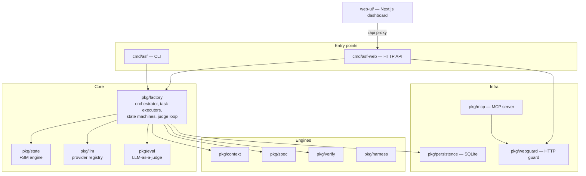
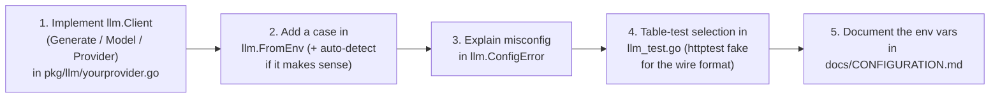

# Development Guide

How to work on the factory itself: build, test, conventions, and the extension points.

## The loop

```bash
go build ./...                      # the whole repo must always compile
go vet ./...
go test ./...                       # unit tests (state machines, providers, judge loop)
cd web-ui && npx tsc --noEmit       # dashboard typecheck
```

All four are expected green on every commit.

## Where things live



## Conventions (the load-bearing ones)

1. **State strings are frozen.** Values persisted to SQLite / served over JSON (`pending`, `running`, `idle`, …) never change. Add states by extending the machines in `pkg/factory/states.go`, `pkg/verify`, `pkg/integration` — and mirror UI-facing ones in `web-ui/src/lib/stateMachine.ts`. After any machine change, regenerate the doc:
   ```bash
   ./asf factory states --markdown > docs/STATE_MACHINES.md
   ```
2. **Terminality comes from the machine.** Use `TaskMachine.IsTerminal(status)` / the API's `terminal` field — never `status == "completed" || status == "failed"`.
3. **Snapshots across the lock boundary.** Anything handed to HTTP/SSE/MCP handlers is a copy made under `fo.mu` (`GetTaskResult`, `RecentTasks`, `GetFactoryStatus`). Never leak a live `*Task`.
4. **Paid calls go through `withLLMSlot`.** Every provider call (generation *and* judging) acquires the concurrency semaphore and the 10-minute timeout.
5. **Prompt-only mode must keep working.** Every task type degrades gracefully without credentials — tests assert this (`newTestFactory` requires a prompt-only start before injecting stubs).
6. **Don't commit artifacts.** Binaries (`asf`, `asf-web-bin`), runtime state (`.asf/`), and `web-ui/node_modules|.next` are gitignored; avoid `git add -A` sweeping new build outputs in.

## Extension point: add an LLM provider



If the provider speaks the Chat Completions wire format, don't write a new HTTP client — construct `openAICompatClient` with your defaults, as the `ollama` provider does.

## Extension point: add a task type

1. Write the executor in `pkg/factory` (`executeYourType(ctx, task) error`) — build prompts via `buildTaskParts`, call the model via `withLLMSlot`, and give it a prompt-only fallback (`promptOnlyResult`).
2. Register it in the `executeTask` switch.
3. Map a dashboard action to it in `cmd/asf-web`'s `launchTaskTypes`, and add it to the MCP `submit_task` enum in `pkg/mcp`.
4. Errors you return flow through the retry state machine automatically (3 attempts, then terminal `failed`).

## Testing patterns in use

| Pattern | Where |
|---|---|
| Table-driven transition tests for FSMs | `pkg/state/state_test.go` |
| Provider selection matrix with env isolation (`clearEnv`) | `pkg/llm/llm_test.go` |
| Fake wire-format server (`httptest`) for round trips | `pkg/llm/llm_test.go` (`fakeOllama`) |
| Scripted stub agent driving the judge loop deterministically | `pkg/factory/factory_test.go` |
| Isolation from real local services | `OLLAMA_HOST=127.0.0.1:1` pinning in test setup |

## Verifying by running

The repo is its own best test subject: `./asf verify` runs build/test/lint on the working tree, and launching the stack (see [GETTING_STARTED.md](GETTING_STARTED.md)) against a local Ollama exercises the entire pipeline — provider detection, generation, judging, persistence, SSE, dashboard — at zero cost.
