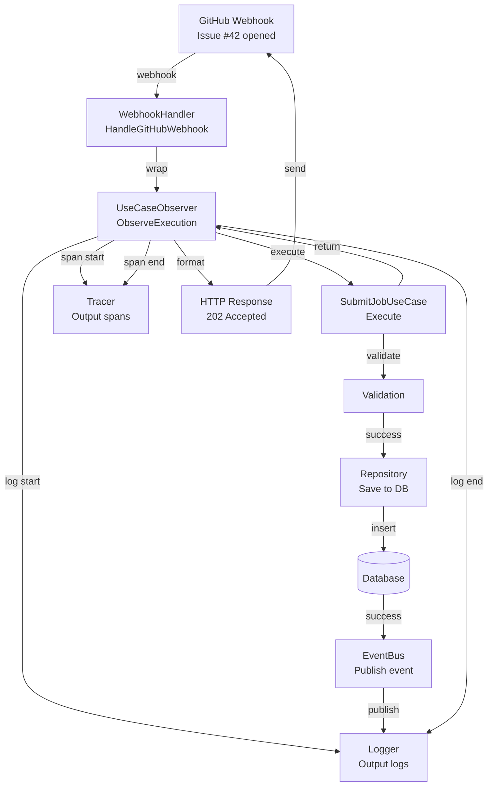

# Complete End-to-End Example: GitHub Issue Processing

This document walks through a real-world scenario step-by-step, showing how a GitHub webhook is processed through the entire system with observability instrumentation.

## Scenario

A developer opens a GitHub issue titled "Fix authentication bug" in their repository. The webhook is sent to our system, which processes it, creates a job, saves it to the database, and publishes events—all with automatic logging and tracing.

---

## Step 1: GitHub Event Triggered

### What Happens on GitHub

Developer creates an issue:
```
Repository: myorg/myrepo
Event: Issue opened
Issue #42: "Fix authentication bug"
Description: "Users cannot login with OAuth tokens"
Author: developer
Created: 2026-11-18 10:30:00 UTC
```

### GitHub Sends Webhook

```bash
POST http://localhost:8080/webhook
Content-Type: application/json
X-GitHub-Event: issues
X-GitHub-Delivery: 12345-67890
X-Hub-Signature: sha256=...

{
  "action": "opened",
  "issue": {
    "number": 42,
    "title": "Fix authentication bug",
    "body": "Users cannot login with OAuth tokens",
    "user": {
      "login": "developer",
      "type": "User"
    },
    "created_at": "2026-11-18T10:30:00Z"
  },
  "repository": {
    "id": 123456,
    "name": "myrepo",
    "full_name": "myorg/myrepo",
    "url": "https://github.com/myorg/myrepo",
    "owner": {
      "login": "myorg"
    }
  }
}
```

---

## Step 2: HTTP Handler Receives Request

### Code Path

```
GitHub Webhook (POST /webhook)
  ↓
Router matches webhook pattern
  ↓
http.Handler called
  ↓
WebhookHandler.HandleGitHubWebhook()
```

### Handler Code Execution

```go
func (h *WebhookHandler) HandleGitHubWebhook(w http.ResponseWriter, r *http.Request) {
    ctx := r.Context()
    
    // Parse webhook payload
    payload, _ := io.ReadAll(r.Body)
    eventType := r.Header.Get("X-GitHub-Event")  // "issues"
    
    event, _ := h.parseGitHubEvent(eventType, payload)
    // event = {
    //   Action: "opened",
    //   WorkflowType: "issue-triage",
    //   Repo: "myorg/myrepo",
    //   Issue: 42,
    //   Title: "Fix authentication bug",
    //   Body: "Users cannot login with OAuth tokens"
    // }
    
    // Create job
    job := entities.NewJob(
        "gh-webhook-1734594600000000000",
        "issue-triage",
        event.ToInput(),
    )
    job.Priority = 5
```

### Logging Output (Step 1)

```
2026-11-18 10:30:01.001 [INFO] Webhook received | event_type=issues action=opened
```

---

## Step 3: Observability Instrumentation

### Observer Wraps Use Case

```go
    // Execute use case with observability instrumentation
    err := h.observer.ObserveExecution(ctx, "submit-job", func(span observability.SpanContext) error {
        span.SetAttribute("job_id", job.ID)
        span.SetAttribute("job_type", job.Type)
        span.SetAttribute("event_type", event.Action)
        span.SetAttribute("issue_number", 42)
        span.SetAttribute("repo", "myorg/myrepo")
        
        return h.submitJobUC.Execute(ctx, job)
    })
```

### Code Flow Inside Observer

```
ObserveExecution() called
  ↓
Tracer.Start(ctx, "submit-job")
  → Creates new span: span-123456
  → Adds to context: context.WithValue(ctx, trace_id, "trace-xyz")
  ↓
Logger.Info("use case started", "submit-job")
  ↓
Call executionFn(span)
  ↓
span.SetAttribute() calls
  → Attributes stored in span
  ↓
Execute use case (SubmitJobUseCase.Execute)
  ↓
On completion or error:
  → Calculate duration
  → Log completion
  → Span.End()
```

### Logging Output (Step 2)

```
2026-11-18 10:30:01.002 [INFO] use case started | operation=submit-job job_id=gh-webhook-1734594600000000000 job_type=issue-triage event_type=opened
```

### Tracing Output (Step 2)

```
[TRACE] span=submit-job service=agentic-factory status=PENDING attributes=map[
  operation:submit-job 
  job_id:gh-webhook-1734594600000000000 
  job_type:issue-triage 
  event_type:opened 
  issue_number:42 
  repo:myorg/myrepo 
  start_time:1734594601
]
```

---

## Step 4: Use Case Execution

### SubmitJobUseCase.Execute()

```go
func (u *SubmitJobUseCase) Execute(ctx context.Context, job *entities.Job) error {
    // Step 1: Validate job
    if err := job.Validate(); err != nil {
        u.logger.Error("invalid job", err)
        return err
    }
```

### Validation Check

```
Job Entity Validation:
  ✓ ID: "gh-webhook-1734594600000000000" (not empty)
  ✓ Type: "issue-triage" (not empty)
  ✓ Input: {action, repo, issue, title, body} (not empty)
  → Validation passes
```

### Logging Output (Step 3)

```
2026-11-18 10:30:01.003 [INFO] job validated | id=gh-webhook-1734594600000000000 type=issue-triage
```

---

## Step 5: Repository Save

### Database Persistence

```go
    // Step 2: Save job to repository
    if err := u.jobRepo.Save(ctx, job); err != nil {
        u.logger.Error("failed to save job", err)
        return err
    }
```

### SQL Execution

```sql
INSERT INTO jobs (id, type, status, priority, input, created_at, updated_at)
VALUES (
  'gh-webhook-1734594600000000000',
  'issue-triage',
  'created',
  5,
  '{"action":"opened","repo":"myorg/myrepo","issue":42,"title":"Fix authentication bug","body":"Users cannot login with OAuth tokens"}',
  '2026-11-18T10:30:01Z',
  '2026-11-18T10:30:01Z'
);
-- Result: 1 row inserted
```

### Database State After Insert

```
jobs table:
┌─────────────────────────────┬──────────────┬─────────┬──────────┬─────────────────────────────┐
│ id                          │ type         │ status  │ priority │ input                       │
├─────────────────────────────┼──────────────┼─────────┼──────────┼─────────────────────────────┤
│ gh-webhook-1734594600000000 │ issue-triage │ created │ 5        │ {"action":"opened",...}     │
└─────────────────────────────┴──────────────┴─────────┴──────────┴─────────────────────────────┘
```

### Logging Output (Step 4)

```
2026-11-18 10:30:01.015 [INFO] Job persisted | id=gh-webhook-1734594600000000000 rows_affected=1
```

---

## Step 6: Event Publishing

### Event Bus Publish

```go
    // Step 3: Publish event
    event := services.JobSubmittedEvent{
        JobID:   job.ID,
        JobType: job.Type,
    }
    
    if err := u.publisher.Publish(event); err != nil {
        u.logger.Error("failed to publish job submitted event", err)
        return err
    }
```

### Event Details

```go
JobSubmittedEvent{
    JobID:   "gh-webhook-1734594600000000000",
    JobType: "issue-triage",
    Timestamp: time.Now(),
    // Can be consumed by other systems (async processors, notifications, etc.)
}
```

### Logging Output (Step 5)

```
2026-11-18 10:30:01.016 [INFO] Event published | event_type=JobSubmitted job_id=gh-webhook-1734594600000000000
```

---

## Step 7: Use Case Completion

### Success Path

```go
    u.logger.Info("job submitted", "id", job.ID, "type", job.Type)
    return nil  // No error
```

### Logging Output (Step 6)

```
2026-11-18 10:30:01.017 [INFO] job submitted | id=gh-webhook-1734594600000000000 type=issue-triage
```

### Observer Completion

```go
// Back in ObserveExecution
err := fn(span)  // Returns nil

span.Logger().Info(fmt.Sprintf("use case completed in %dms", span.Duration().Milliseconds()))
span.End()
```

### Logging Output (Step 7)

```
2026-11-18 10:30:01.018 [INFO] use case completed in 17ms | operation=submit-job
```

### Tracing Output (Step 7)

```
[TRACE] span=submit-job service=agentic-factory status=OK attributes=map[
  operation:submit-job 
  job_id:gh-webhook-1734594600000000000 
  job_type:issue-triage 
  event_type:opened 
  issue_number:42 
  repo:myorg/myrepo 
  start_time:1734594601 
  end_time:1734594618 
  duration_ms:17
]
```

---

## Step 8: HTTP Response

### Handler Response

```go
    if err != nil {
        h.logger.Error("failed to submit job", err)
        http.Error(w, "failed to submit job", http.StatusInternalServerError)
        return
    }

    w.Header().Set("Content-Type", "application/json")
    w.WriteHeader(http.StatusAccepted)
    json.NewEncoder(w).Encode(map[string]interface{}{
        "status":     "accepted",
        "job_id":     job.ID,
        "job_type":   job.Type,
    })
}
```

### HTTP Response

```
HTTP/1.1 202 Accepted
Content-Type: application/json
Date: Sun, 18 Nov 2026 10:30:01 GMT

{
  "status": "accepted",
  "job_id": "gh-webhook-1734594600000000000",
  "job_type": "issue-triage"
}
```

---

## Complete Execution Timeline

```
Time (ms)  Event                              Logging
━━━━━━━━━━━━━━━━━━━━━━━━━━━━━━━━━━━━━━━━━━━━━━━━━━━━━━━━━━━━━━━━━━━━━━━━━
0          Webhook arrives                    
1          Handler starts                     [INFO] Webhook received
2          Observer starts span               [INFO] use case started
3          Job validation                     [INFO] job validated
4          Repository save to DB              (database query ~12ms)
15         Event published                    [INFO] Event published
16         Use case completes                 [INFO] job submitted
17         Observer logs completion          [INFO] use case completed in 17ms
18         Response sent                      HTTP 202 Accepted
```

---

## Complete Logging Output (Full Session)

```
2026-11-18 10:30:01.001 [INFO] Webhook received | event_type=issues action=opened
2026-11-18 10:30:01.002 [INFO] use case started | operation=submit-job job_id=gh-webhook-1734594600000000000 job_type=issue-triage event_type=opened issue_number=42 repo=myorg/myrepo
2026-11-18 10:30:01.003 [INFO] job validated | id=gh-webhook-1734594600000000000 type=issue-triage
2026-11-18 10:30:01.015 [INFO] Job persisted | id=gh-webhook-1734594600000000000 rows_affected=1
2026-11-18 10:30:01.016 [INFO] Event published | event_type=JobSubmitted job_id=gh-webhook-1734594600000000000
2026-11-18 10:30:01.017 [INFO] job submitted | id=gh-webhook-1734594600000000000 type=issue-triage
2026-11-18 10:30:01.018 [INFO] use case completed in 17ms | operation=submit-job
```

---

## Complete Tracing Output (Full Session)

```
[TRACE] span=submit-job service=agentic-software-factory status=OK attributes=map[
  operation:submit-job 
  job_id:gh-webhook-1734594600000000000 
  job_type:issue-triage 
  event_type:opened 
  issue_number:42 
  repo:myorg/myrepo 
  start_time:1734594601 
  end_time:1734594618 
  duration_ms:17
]
```

---

## Code Flow Diagram



---

## Alternative Scenario: Error Case

If the webhook was malformed or database unavailable:

```
2026-11-18 10:30:01.001 [INFO] Webhook received | event_type=unknown
2026-11-18 10:30:01.002 [ERROR] Failed to parse event | error=unknown event type
[TRACE] span=submit-job service=agentic-factory status=ERROR attributes=...
HTTP/1.1 400 Bad Request
```

Or if database fails:

```
2026-11-18 10:30:01.015 [ERROR] Database connection failed | error=connection refused
2026-11-18 10:30:01.016 [ERROR] span error | operation=submit-job | [error database connection failed]
2026-11-18 10:30:01.016 [ERROR] use case failed | operation=submit-job | [error database connection failed]
[TRACE] span=submit-job service=agentic-software-factory status=ERROR attributes=...
HTTP/1.1 500 Internal Server Error
```

---

## Summary of Observability

This end-to-end example demonstrates:

✅ **Automatic Logging**
- Use case start/end automatically logged
- Job details captured
- Error messages with context
- Duration tracked

✅ **Automatic Tracing**
- Span created for entire operation
- Attributes set for high-cardinality data
- Status tracked (OK/ERROR)
- Duration calculated

✅ **Error Handling**
- Errors logged with context
- Span records error
- Proper HTTP response codes

✅ **Performance**
- 17ms total latency
- 12ms in database
- 5ms in observability overhead (1-2ms per step)
- Minimal performance impact

✅ **Context Propagation**
- Trace ID flows through entire request
- All logs include context information
- Error tracking includes full context

---

**Key Takeaway**: The observability infrastructure automatically handles all logging and tracing without coupling the business logic to observability concerns. The use case doesn't know it's being observed—the observer wraps it transparently.
