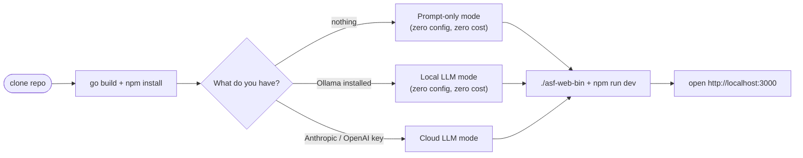

# Getting Started

From clone to a running factory in a few minutes. Pick your mode:



## Prerequisites

- **Go 1.23+**
- **Node.js 18+** (for the dashboard)
- Optional: [Ollama](https://ollama.com) for free local models, or an Anthropic/OpenAI API key

## 1. Build

```bash
go build -o asf ./cmd/asf              # CLI
go build -o asf-web-bin ./cmd/asf-web  # API server
cd web-ui && npm install && cd ..      # dashboard deps
```

## 2. Run (two terminals)

```bash
# Terminal 1 — Go API server on :8080 (starts the factory + workers)
./asf-web-bin localhost:8080

# Terminal 2 — dashboard on :3000 (proxies /api/* to :8080 in dev)
cd web-ui && npm run dev
```

Open http://localhost:3000. The startup log tells you which LLM mode you're in:

```
factory: LLM enabled (provider ollama, model granite4.1:3b, ...)   ← LLM mode
factory: no LLM provider configured — running in prompt-only mode  ← no LLM
```

## 3. Choose your LLM mode

### Prompt-only (no LLM)

Nothing to configure. Tasks complete with the fully-assembled prompt (spec + project context) as their result — useful for inspecting exactly what an agent *would* receive.

### Local with Ollama (free)

```bash
# one-time
ollama pull granite4.1:3b        # or any chat model

# then just run the server — Ollama is auto-detected
./asf-web-bin localhost:8080

# pin a specific model (recommended; auto-pick takes the first installed one)
ASF_MODEL=granite4.1:3b ./asf-web-bin localhost:8080
```

### Cloud (Anthropic or OpenAI)

```bash
# Anthropic — defaults to claude-opus-4-8
export ANTHROPIC_API_KEY=sk-ant-...
./asf-web-bin localhost:8080

# OpenAI — model must be chosen explicitly
export OPENAI_API_KEY=sk-...
ASF_MODEL=<model-id> ./asf-web-bin localhost:8080
```

Any other Chat-Completions server (vLLM, Groq, Mistral, LM Studio):

```bash
ASF_LLM_PROVIDER=openai-compatible \
ASF_LLM_BASE_URL=https://your-server/v1 \
ASF_MODEL=<model-id> \
./asf-web-bin localhost:8080
```

The full decision tree is in [ARCHITECTURE.md § Provider selection](ARCHITECTURE.md#provider-selection); every knob is in [CONFIGURATION.md](CONFIGURATION.md).

## 4. Launch your first task

**From the dashboard:** pick a spec in the LaunchPad selector, click **Generate**. Watch the button run its lifecycle (loading → ✓ Launched → reset), the Factory Status workers go busy, and the task appear in Recent Activity with its judge verdict.

**From the shell:**

```bash
ID=$(curl -s -X POST localhost:8080/api/factory/launch/feature \
  -H 'Content-Type: application/json' -d '{"spec_id":"spec-001"}' | jq -r .task_id)

curl -N localhost:8080/api/tasks/$ID/stream    # SSE until the task is terminal
curl -s localhost:8080/api/tasks/$ID | jq .result.evaluation   # judge verdict
```

**From the CLI:**

```bash
./asf spec list                      # what specs exist
./asf verify                        # run build/test/lint on this repo
./asf factory states                # print the state machines
```

## 5. Write your own spec

```bash
./asf spec template specs/my-feature.yaml   # scaffold
$EDITOR specs/my-feature.yaml               # fill in intent, constraints, steps
./asf spec validate my-feature              # check it
```

The spec format is documented field-by-field in the [README § Specification Format](../README.md#specification-format).

## Troubleshooting

| Symptom | Cause / fix |
|---|---|
| `running in prompt-only mode — <reason>` in the log | The log line names the exact missing config; see [CONFIGURATION.md](CONFIGURATION.md) |
| Dashboard says **Unreachable** | `asf-web` isn't running — start it; the panel reconnects automatically |
| Launch button shows **Failed — Try Again** | Open Recent Activity: the task row carries the real error (e.g. `spec not found`) |
| Ollama tasks are slow | Pin a small model (`ASF_MODEL=granite4.1:3b`); context is already budgeted to ~24K chars for local providers |
| `403 non-local requests require ASF_API_TOKEN` | You're calling the API from a non-loopback address — see [SECURITY.md](SECURITY.md) |
