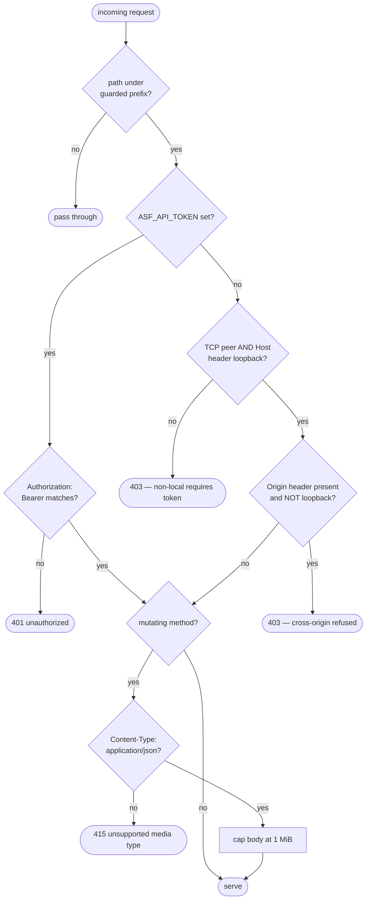
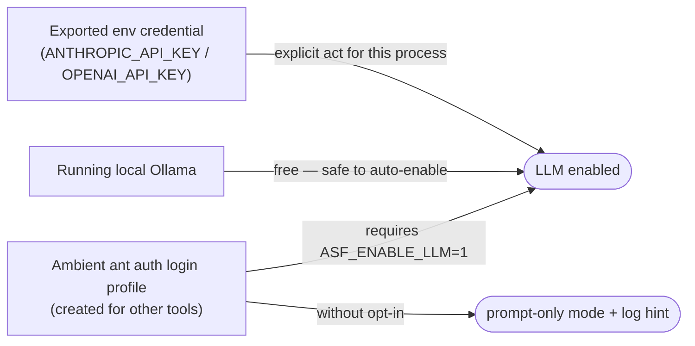

# Security Model

The factory's HTTP surfaces can trigger **credential-spending LLM tasks**, so both of them — the web API (`/api/*`) and the MCP server (`/mcp`) — share one guard: `pkg/webguard`. The threat model is a local dev tool that must not be abusable by the web pages you browse or by other machines, with an explicit, deliberate path to non-local deployment.

## The guard, visually

Every request to a guarded prefix walks this decision tree (`pkg/webguard/webguard.go`):

## What each check defends against

| Check | Attack it stops |
|---|---|
| TCP peer (`RemoteAddr`) must be loopback | Direct remote connections — the peer address cannot be spoofed by any header |
| `Host` header must be loopback | **DNS rebinding** — a malicious domain resolving to 127.0.0.1 carries its own hostname in `Host` |
| `Origin` (when present) must be loopback | **CSRF** — any website you visit can fire `fetch('http://localhost:8080/...', {method: 'POST'})`; the browser attaches the page's Origin |
| `Content-Type: application/json` required on POST/PUT/PATCH | HTML-form CSRF — forms cannot send `application/json` without a CORS preflight |
| 1 MiB body cap | Resource exhaustion |
| `ASF_API_TOKEN` bearer auth | The deliberate path for non-local use; when set, it replaces the loopback rules entirely |

> **Known residual:** a local reverse proxy that accepts remote traffic satisfies the loopback checks (the proxy *is* the TCP peer). Any such deployment **must** set `ASF_API_TOKEN`. The same applies to the Next.js dashboard — its production `/api` rewrite only activates when `ASF_API_URL` is set explicitly, and `npm run dev` binds to `127.0.0.1`.

## Credential policy for the LLM

Spending money requires an explicit act:

Two further cost controls:

- **Concurrency cap** — at most `ASF_LLM_MAX_CONCURRENT` (default 2) simultaneous paid calls, independent of the worker pool, so a task-queue flood cannot fan out into parallel credit burn.
- **Per-call timeout** — every provider call is bounded at 10 minutes.

## Data-safety properties

- **Task snapshots, not live pointers** — `GetTaskResult`/`RecentTasks` return copies taken under the orchestrator lock; HTTP/SSE/MCP handlers never race with worker mutations.
- **No secrets in results or logs** — prompts contain project source (by design: that's the context), never credentials; credentials live only in environment resolution inside the provider clients.
- **Sandboxed execution available** — `pkg/security` carries the Docker sandbox config (resource limits, restricted network) for executing untrusted agent-generated code; wiring it into the verify path is the intended future hardening.

## Verified behavior

These were exercised live against running servers (see commit history):

| Request | Result |
|---|---|
| Local JSON POST to `/api/factory/launch/...` | ✅ 202, task created |
| Same POST with `Origin: https://evil.example` | ❌ 403 |
| Form-encoded POST (CSRF shape) | ❌ 415 |
| Spoofed `Host: evil.example` | ❌ 403 |
| Same four against `/mcp` | Same outcomes |
