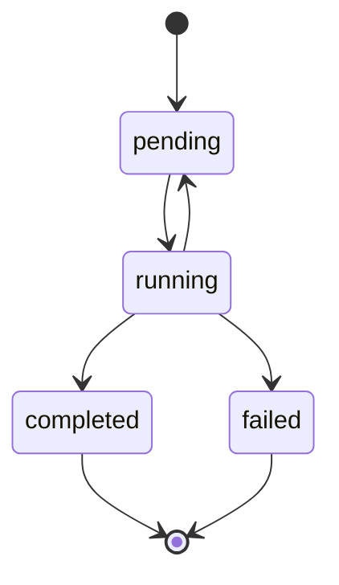
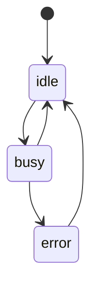
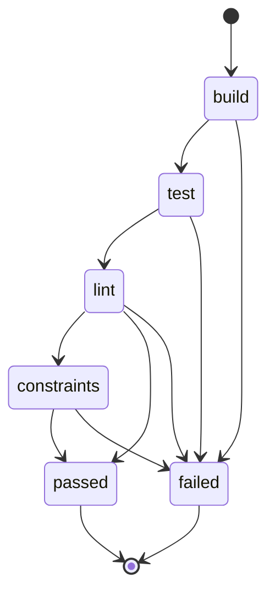
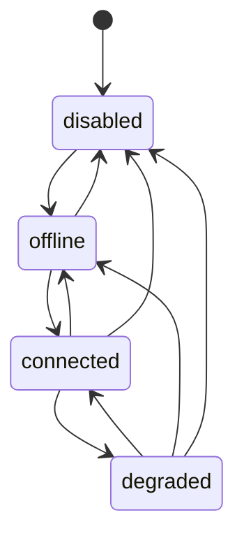

# State Machines

Every lifecycle in the Agentic Software Factory is an explicit, declared
state machine (see `pkg/state`). This document is generated — regenerate
with `asf factory states --markdown > docs/STATE_MACHINES.md`.

The same declarations are served at runtime from `GET /api/state-machines`
(asf-web) and are mirrored for the dashboard in `web-ui/src/lib/stateMachine.ts`.

## task

Initial state: `pending`

## worker

Initial state: `idle`

## verification

Initial state: `build`

## integration-connection

Initial state: `disabled`

